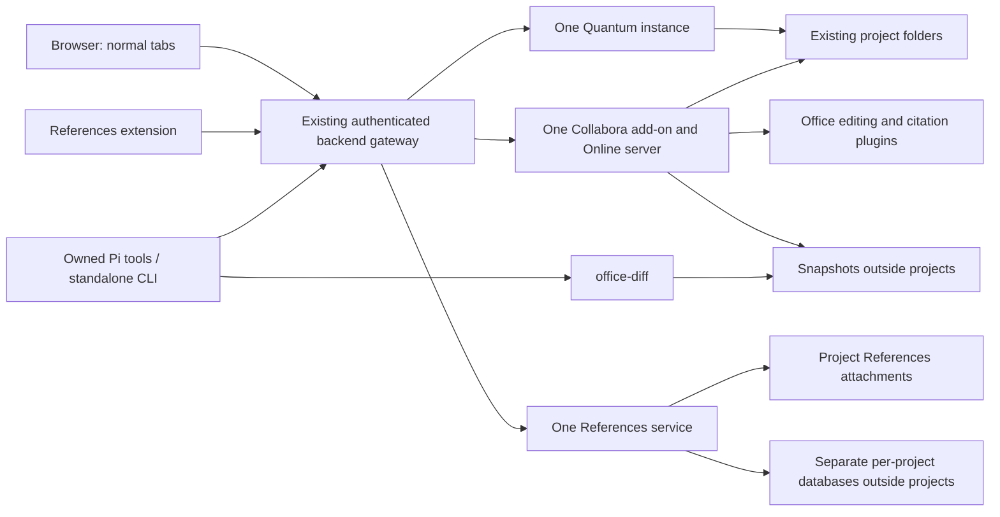

# BashKitten Files, Office and References integration plan

Requested and researched **28 October 2026**. **Plan only:** this document does
not claim that any component is imported, ported, integrated or accepted. The
research baseline is BashKitten `dd8db0849b0f4a0bc3d3960b2d1953ffda007a86`.
Implementation and acceptance evidence must be recorded separately in
[the Office status record](office-integration-status.md).

## 1. Controlling user decisions

This is the dated replacement specification for Files, Office, document
comparison, References and Systematic Reviewer. The user's latest request
supersedes conflicting earlier viewer/conversion plans and implementations,
including the internal Files manager, SheetJS spreadsheet viewer and
LibreOffice-based document preview/export path. Remove those paths cleanly
during implementation; do not preserve a second implementation behind a flag.

Preserve the original native plan at
`f71686dcb76402ec43bac3e6a7db8979ef0fb119`, tagged
`bashkitten/plan/native-environments-2026-10-11`, and its historical evidence.
The [current native plan](native-environments-display-plan.md) continues to
govern unrelated features and existing ownership, transport and packaging.
This amendment records the user's new requirements instead of rewriting the
old baseline or treating obsolete requirements as a reason to retain old code.

Later clarifications on the same date narrow the integration further: Files is
only a folder-button link to its normal web tab; Office opens through Quantum's
web UI; Office diffs are only an optional Pi/CLI tool for saved Office snapshots.
There is no Office-diff UI, Git integration or browser bridge. Reuse native
Office collaboration and history surfaces, with the minimum storage/API adapters.
Most module work must be buildable and testable without rebuilding the browser.
The library manager, capture connector and agent-facing descriptions are named
**References**. Bibliography remains the formatted-output command in Office and
the originally requested attachment folder name; internal storage/documentation
identifiers do not require renaming merely to change the product label.

### User amendment — 28 October 2026: Collabora selection and browser-first iteration

The user selects **Collabora Online** throughout the active
architecture: Quantum document opening, Pi live editing, native saves/exports,
snapshot history, References citations, packaging, source/notices and builds.
Earlier plan revisions remain recoverable in Git history. The selection follows
a local runtime comparison; those observations are not a controlled performance
guarantee or installed-product acceptance.

Office must open with a **light UI and light document canvas**, independently of
BashKitten's surrounding theme, the operating system's theme and old browser
preferences. Preserve actual stored cell fills, font colors, slide backgrounds
and document formatting. Do not recolor document data to simulate a light view.

Keep Quantum mergeable/updatable: the Collabora/WOPI adapter is a separately
versioned add-on module with its own tests and package. Reuse an upstream hook if
available; otherwise keep one small, named, documented launcher/registration
patch. Do not fold WOPI, storage/history, agent editing or citation logic into
Quantum's existing OnlyOffice implementation or spread it across its internals.
Recheck released upstream Collabora support on upgrades and retire our hook when
an equivalent native extension point becomes available without losing scope.

The user additionally authorizes an **early browser integration build** after the
small native hooks, old file-manager removal and Android chat-height regression
fix. Backends/plugins may still be under development. This is an explicit narrow
exception to the older requirement to finish every feature before any full
browser build; it is an iteration build, not full feature acceptance or permission
to remove unfinished requirements. See section 15.3 for its concrete boundary.

### User clarification — 28 October 2026: editing and browser inspection

Agent editing must work without requiring an open editor web UI. This is not a
restriction on using the browser: agents can open the same document in an
ordinary BashKitten tab to inspect its rendering, preview results and check
exports whenever useful. Expose both native editing/export operations and normal
browser-view URLs. Test the independently runnable modules in parallel with the
early browser batch; neither sequence reduces the required feature scope.

### User clarification — 29 October 2026: citation commands without a side panel

Office must not open a References side panel. Use its native citation menu and
plugin command facilities on desktop and phones. Each action needs a readable
text label; a row of identical, unlabelled icons is insufficient. Keep
Add/Edit Citation, Add Bibliography, Convert and Settings in the citation menu,
with the relevant Edit/Remove and Refresh actions. Bibliography and conversion
are commands, not document settings. The separately opened References library
web application retains its own library-management interface.

There is one document Settings surface. Its first control is the project
Library dropdown, followed by citation Style, Language and applicable document
preferences. Show human-readable style and language names in dropdowns, including
the current style when it lies outside the first search page. Raw locale codes
or style identifiers are not substitutes for those controls. On the first
citation-related action in an unconfigured document, open Settings first to
choose its library and style; an agent may also configure that same binding.

Selecting or placing the caret anywhere within an existing managed citation
must let Edit and Remove act on that citation. The native secondary-click menu
must offer the corresponding actions. Edit reopens the same compact citation
chooser with the existing sources, order and citation options filled in; do not
require selecting a citation ID from a separate panel. Retain the equivalent
cell/shape behavior in Calc and Impress through their native selection APIs.

An inserted bibliography remains managed and updates when citation commands
add, edit or remove citations or change the document style, as in the native
reference-manager workflow. Reuse the existing rendering and native document
operations; do not add a separate polling or bibliography engine. Preserve the
existing formatted-text conversion/export capability and the explicit warning
when changing a bound library would unlink existing citations and bibliography.

### User clarification — 28 October 2026: HTTPS and existing browser trust

Files, Collabora and References browser-facing URLs must use HTTPS with
BashKitten's existing certificate identity/trust handling, including ordinary
tabs and the exact authorized Chisel service mapping. Reuse the existing TLS
owner and local certificate mechanism; do not add warning bypasses, global
certificate exceptions or a second trust system. Internal private Unix/backend
connections may retain their existing transport. Editor assets, sockets,
downloads and callbacks must retain the appropriate external HTTPS/WSS versus
internal endpoint distinction without mixed-content failures.

The privileged References host provides capture and browser-assisted resolver
access. It is not a certificate-validation bypass. Verify the trusted HTTPS
loading flows in the installed BashKitten browser; another browser can exercise
independent web UI behavior but does not establish BashKitten trust acceptance.

### Mandatory implementation rule for all agents and subagents

The standalone components have their own repository roots: `files/`, `office/`
and `references/`. Keep only existing backend lifecycle/authorization adapters
and Pi-facing tools under `agent/`; source placement must not imply that Pi owns
the applications. Reuse the existing package installation layout where useful.
An agent's separate native Office participant is authorized by the existing
backend. It does not require the user to create another account or log in to
another service. References remains a normal web app; the browser capture host
and the Office citation plugin are separate, narrow integration components.

**If the selected native app can provide the requested function, use that
function. Only implement a pluggable module for what is genuinely missing or
cannot work through the app's existing facilities.** This applies to every
implementing agent and all nested subagents, and must be included in each task
handoff. It is an implementation constraint, not a suggestion to consider later.

Inspect the pinned application's configuration, UI, APIs, plugin facilities and
existing source before designing new machinery. Prefer configuration, then
native APIs/plugins with a small adapter. A new module must name the concrete
gap it fills; do not duplicate collaboration, save timers, history viewers,
format conversion, editing engines, service ownership or other existing native
behavior. Reuse BashKitten's existing facilities on its side of the connection
too. When research finds the feature already exists, remove the proposed
replacement from the implementation scope. Necessary missing features remain
required, but belong in the smallest separately iterable adapter/module.

**References has a packaging exception, not a blanket rewrite exception:** the
full desktop Zotero app is not the requested backend-only component. Reuse the
relevant reference-management, translator, resolver, citation and Connector
code/behavior while adapting its persistence/runtime/UI boundary. Do not bundle
the entire desktop application, and do not use that exclusion to rewrite
reusable algorithms or save logic. The rest of the integrated applications
should use their native functionality wherever it satisfies the request.

The binding boundaries are:

- **Files:** a one-click folder icon in our sidecar opens File Browser Quantum
  as a normal web tab. Backend headings (Local/container/remote) can expose the
  same button; a project launch selects its existing folder. No synchronized
  copy, per-project home directory or new workspace folder is required.
- **Office:** Collabora Online, connected from Files, with human and agent editing
  the same live document using its actual editing APIs. Ordinary web tabs own
  its UI. Clicking a document in Quantum uses its natural Office web integration;
  there is no separate Mozilla Office-opening or rendering integration.
- **References:** a BashKitten-branded web library manager and backend, with
  one independent library per project, plus a small browser capture/resolver
  extension. The screenshot specifies layout and functions, not its palette.
- **Browser capture:** our own **References** extension, reusing Zotero
  Connector's actual detection, selection, save and attachment logic. No
  Zotero Connector product name, logo, trademark branding or misleading
  affiliation in the product UI. Preserve required attribution and notices in
  legal/source information and imported source.
- **PDFs:** ordinary browser PDF tabs, including PDFs opened from Files or
  References. No new native PDF reader or imported Zotero reader UI.
- **Mozilla changes:** small tab-launch, built-in-extension packaging/lifecycle
  and narrowly scoped privileged bridge hooks. Library management, Office
  editing, citation dialogs, storage, search and resolution belong to separately
  iterable modules. The Files button uses normal navigation; the privileged
  extension is for References capture/resolvers. Keep folder pickers and the
  existing Git Changes sidecar without adding Office comparison to it.
- **One service set per environment:** one Quantum server and one Collabora Online
  server with its native document-kit workers for the native Linux backend, one for each separate
  managed VM/container backend, and one for Termux. All chats, projects,
  folders and documents in an environment share them. Collabora needs no separate
  PostgreSQL/Redis/RabbitMQ stack. Its native per-document workers remain part
  of the one server, not per-chat servers.
- **Platforms:** native Linux and native Termux/Android, including the supported
  amd64/x86_64 and arm64/aarch64 package targets. Remote connections reuse the
  server's existing instances through the existing authorized tunnel.
- **Resources:** retain Collabora's upstream process/resource defaults initially;
  measure the complete server, adapter and browser under matched workloads. Set
  no unverified memory reservation, hard limit or guarantee. Do not tune workers
  merely to reproduce the comparison.
- **Implementation:** use configuration and upstream code first, narrow adapters
  where missing, and `gpt-6-astra` with `xhigh` reasoning for complex workstreams.
  A small main-browser diff is required; it does not imply that the backend
  port, citation engine integration and simultaneous editing are trivial.

Every feature below remains in scope. A feasibility gate identifies work that
must be proved, not an optional feature that can silently be omitted.

## 2. Components and ownership

Use the existing backend supervisor, identity, permissions, data root and
packaging. Suggested module names below are implementation boundaries, not a
requirement to introduce another package manager or permanent system service.

| Component | Owns | Main-browser involvement |
| --- | --- | --- |
| Files adapter + Quantum | Source/account reconciliation, file operations, file web UI and a small document-launch hook | One sidecar folder-button URL; ordinary navigation |
| Collabora add-on module + Online | Shared runtime, WOPI storage/launch, native sessions, minimum history/Pi adapters, exports | None specific to Office; reached through Quantum/web URLs |
| `office-diff` CLI/library | Optional Pi/CLI comparison of saved Office snapshots | None; no UI, Git or browser integration |
| References backend | Project databases, metadata, imports, resolver jobs, search, attachments, CSL rendering, compatibility API | None |
| References web UI | Project/collection sidebar, library table, item details, settings and search | Ordinary tab |
| References browser extension | Page/PDF capture, translator execution where browser context is needed, authenticated retrieval and human challenge tabs | Small built-in host bridge |
| Office References plugin | Classic citation modal, style dropdown, document/cell/slide adapters and live citation commands | None; runs inside Office web UI |
| Pi Office/References skills and Systematic Reviewer | Thin authorized tools/CLIs and instructions using those modules | Existing Pi RPC/client only |



Remote access reaches this gateway through the existing Tor/Chisel/Caddy/
Authelia path. The diagram is a logical module diagram, not a new direct network
route. Existing local container control remains separate from published access.
For a remote Files button, navigate to the exact normal service URL returned by
the existing client: `scheme://127.0.0.1:<actual mapped port><openPath>`. Loopback
is the local end of that authorized route, not an authentication bypass or a new
connection to the remote server. Reuse ordinary service-tab storage and opening
behavior; do not put the Files UI in the protected Agent context. Quantum's Office
links/assets/sockets use the same forwarded web origin/routing.

### 2.1 Exactly one runtime set per owning environment

Key the service registry by the existing stable **backend/environment ID**,
never chat ID, project ID or a browser tab. Native Linux is one owner; each
separate container/VM is another; Termux is another. Two browser windows
connected to the same owner must discover the same running services.

`ensureRunning(environment, component)` must coalesce concurrent startup,
acquire one owner lock, verify an existing instance's identity/readiness and
return its endpoint. Use the current supervisor's lifecycle/lock machinery;
do not add independent shell launches in Files, Office, Pi or capture handlers.
After a crash, reconcile stale state before restarting one instance. Several
Office processes/workers required by upstream are one shared stack; a document
participant is a logical session, not another server deployment.

Run Quantum with multiple explicit folder sources and scoped accounts. Run one
Office stack with all authorized document sessions. Run one References service
opening independent project databases as needed. Reuse Office's native save
timers and one shared WOPI storage/history adapter. Bounded per-request workers
do not become additional persistent service stacks.

Start on demand through the existing owner, with saved startup choices handled
by the existing autostart system. Closing a chat or tab must not stop a service
used elsewhere. Backend Off and desktop Quit/crash follow the existing lifetime
rules, including bounded cleanup; remote disconnect never shuts down the remote
host. Termux retains its established background lifetime. A save that could not
finish before termination remains an unresolved/recoverable save, not a success.

The initial default is **lazy startup**, not keeping the entire stack idle from
browser/backend launch:

| First authorized use | Start/reuse |
| --- | --- |
| Sidecar Files button / its ordinary web-service URL | The owning environment's Quantum instance |
| Open an Office document from Quantum, or Pi open/edit/convert/export | The owning environment's Office stack and required file-storage/callback service |
| Open References, capture a reference or request library/citation data | The shared References service |
| Compare existing Office snapshots through Pi/CLI | The read-only tool; no Office renderer/server required |

The existing lightweight backend/gateway remains reachable while its owning
backend is enabled. It authenticates the request and uses the existing supervisor
to start dependencies and wait for readiness, with normal web loading/status
and a useful error if startup fails. No Office-specific browser integration or
additional permanent host daemon is needed. A remote uses the same mechanism
through its established Chisel mapping; an unavailable/off remote backend cannot
be woken merely by opening a loopback URL.

Pi's direct Office path must also ensure the WOPI storage service is
running; reuse Quantum for file authorization/operations where needed, even if the user
has not opened Files. The external add-on owns WOPI endpoints and must work for
direct Pi use without requiring a Files tab. Keep those dependencies alive while documents, conversions,
exports or pending saves need them. Browsing code/images/PDFs must not start the
Office stack unnecessarily, and startup probes/indexing must not eagerly wake it.
Explicit saved autostart choices may prewarm components; they are not required.

For the initial implementation, once started, services follow the existing
backend lifetime. Do not add a custom automatic-idle shutdown subsystem merely
to implement lazy startup. Any later idle-stop option must use native session/job
and save-completion signals, not the last Files-tab close or absence of HTTP
requests. First use can take longer because the services are cold; do not promise
instant startup before measuring it on the selected platform.

Acceptance must inspect process ownership, sockets and database/service data
paths while many projects/chats/tabs open concurrently. Verify one Quantum
instance and one Office dependency stack in each owner, including races,
restarts, duplicate browser windows and direct CLI use.

## 3. Project identity and storage

Reuse UUIDs and owning working directories from
[`agent/src/server/projects.mjs`](../agent/src/server/projects.mjs). Display names
are labels. Every launch, capture, mutation, citation and file-open operation
carries the owning backend and project identity; a name change cannot retarget
an existing request. Ungrouped chats retain their existing folder logic and
receive a scoped Files launch. References capture requires an explicit project
destination, with a create/select-project route rather than a global-library
fallback.

Proposed layout under each owner's existing `$BASHKITTEN_DATA_DIR`:

```text
services/files/                         # one Quantum config/database/cache
services/office/                        # one Office config/dependency state
office-sessions/documents/<document-id>/
  manifest                             # native history entries and saved-file paths
  versions/<version-id>.<format>        # complete saved files
bibliography/<project-id>/
  library.sqlite                       # one independent library database
  ...                                  # indices, operation receipts, local state
```

Names are proposed; reuse established directory conventions when implementing.
Service secrets/settings stay in private backend storage. Project files remain
in place, and bibliography attachments live in:

```text
<project>/Bibliography/<library-id>/<item-key>/<attachment-key>-<name>.pdf
```

The nested stable IDs avoid collisions when projects share a folder or items
share titles. PDFs, EPUBs and saved web snapshots use the appropriate extension;
the requested `Bibliography` directory is created only when needed for imports.
No Office history, SQL database, cache or credentials is stored in `.git` or
automatically added to the repository.

Extend the existing canonical private-path exclusions for the new service,
Office-session and library-state directories. A broad home/project source must
not expose them through Quantum, direct paths or symlink aliases. Retaining
`access.mjs` alone is insufficient: its current list does not know these new
paths. Authorized history/library APIs expose their intended records, not raw
service secrets, databases or unrestricted private-directory downloads.

Document identity is **environment-wide**, with a separate authorization binding
to each project that can reach the file. Opening the same actual file through
two projects must reuse its active Office room and save owner, not create two
writers. Handle rename/move identity explicitly; do not identify documents by
display title, current content hash alone, or a stale inode alone. New content
generations and path authorization are distinct from durable document identity.

Project rename preserves its library. Moving its root requires an explicit
attachment-path reconciliation; unavailable roots remain unavailable. Removing
a project from navigation must not silently erase its library or attachments.
Provide archive/relink and deliberate deletion through the existing lifecycle
patterns. Never merge two project databases because their names match.

## 4. Files: Quantum configuration and integration

Use the verified stable candidate
[`v2.0.2-stable`](https://github.com/gtsteffaniak/filebrowser/releases/tag/v2.0.2-stable),
commit `2c071d1e6eb48d4b88da2657885d345663a0a88b`. The previously inspected
`b0f6d53…` is a beta, not this stable baseline. Recheck official stable releases
when implementation begins, then freeze the chosen source graph.

### 4.1 Scope and presentation

- Register each existing authorized folder as a source in the **shared** server.
  Disable automatic user-folder creation. Keep server DB/cache outside projects.
- Reconcile actual non-admin users and explicit `scopes[].permissions`, including
  existing records. `userDefaults` only seeds accounts and cannot enforce later
  changes. Single-source auto-enabling must not broaden access.
- A one-click sidecar folder button opens the ordinary Quantum URL at the owning
  root, using the existing local or Chisel-forwarded endpoint. Preserve navigation and transfer
  functionality inside that scope, including supported previews, text editing,
  download/upload, new files/folders and rename/move/copy/delete/archive actions.
  Do not add a separate administrative sidecar or manual first-run wizard.
- Office documents open through Quantum's own web UI connector on click. Native
  BashKitten only navigates normal URLs; it does not implement Office routing,
  preview, export, version history or document-event handling.
- Use supported branding/name/favicon/CSS/theme settings, match BashKitten's
  palette and typography, and disable seasonal decoration. Non-admin roles and
  `account.disableSettings` remove irrelevant administration; hidden CSS alone
  never enforces permissions.
- Route PDF opens to normal browser PDF tabs; keep ordinary image/download
  behavior. Quantum's text editor can show patch files, but it is not a Git
  Changes implementation. Preserve the existing Changes sidecar.

Source documentation: [users](https://filebrowserquantum.com/en/docs/configuration/users/),
[branding](https://filebrowserquantum.com/en/docs/configuration/frontend/branding/),
[styling](https://filebrowserquantum.com/en/docs/configuration/frontend/styling/).

### 4.2 Authentication and multiple simultaneous project tabs

Use a private Unix listener where supported and the existing authenticated
gateway as the only entry point. Keep `noAuth` disabled. Launch identities are
non-admin and distinct from the reserved bootstrap administrator. The gateway
must strip caller-supplied identity headers and derive identity from its own
authenticated session and project grant.

Quantum v2.0.x proxy authentication promotes a matching `auth.adminUsername`;
newer documented proxy-role controls are not available in this stable version.
Its JWT identities do not accept arbitrary project-scope claims, and an existing
session cookie does not automatically refresh permissions. Therefore reconcile
real account/source permissions, enforce revocation at the gateway and invalidate
affected Quantum sessions. A URL token must not become a durable credential.

Preserve the host-owned **Allow remote file manager** gate on remote Quantum
launches, operations, active transfers, Office sessions and their subsequent
save callbacks. Revocation stops further use of that grant; pending work cannot
commit under revoked authority. Preserve unresolved save data for recovery or
explicit adoption by an independently authorized local owner, rather than
silently dropping it or treating a callback as a permission bypass. Keep ordinary
chat attachments available under their existing separate policy when Files is
Off. Apply equivalent explicit project/operation authorization to References
capture and attachment access without broadening the existing remote gate.

Multiple project tabs need isolated launch/session context through the shared
gateway: a cookie or last-selected-folder change in one tab must not switch
another tab's authority. Validate the chosen scoped path/origin/header arrangement
against Quantum's actual redirects, cookies, assets and WebSockets before
settling it. This is an integration adapter task, not a second Quantum instance.
See [proxy auth](https://filebrowserquantum.com/en/docs/configuration/authentication/proxy/),
[JWT](https://filebrowserquantum.com/en/docs/configuration/authentication/jwt/)
and [HTTP/socket configuration](https://filebrowserquantum.com/en/docs/configuration/http/).

### 4.3 Maintainable Collabora add-on and slow transport

Quantum `v2.0.2-stable` has an OnlyOffice connector, not a released Collabora/WOPI
connector. Its `integrations.office` configuration and OnlyOffice callback/JWT
protocol cannot be pointed at Collabora as if they were compatible. Inspect
newer released support before implementation; unreleased main-branch work is
reference material, not a replacement for a pinned release. Upstream already merged Collabora/WOPI
work into `dev/v2.2.0`: [PR #3108](https://github.com/gtsteffaniak/filebrowser/pull/3108),
commit `c5112cd51c8479c21cfca49e376cd207242c2595`, followed by the
[token-signing correction #3173](https://github.com/gtsteffaniak/filebrowser/pull/3173),
commit `fd64a470d3a521b0ad026f0f5307c20dd04b472f`. Audit and reuse that donor source
(`backend/internal/web/wopi*.go`, `frontend/src/api/wopi.js`,
`frontend/src/views/files/WopiEditor.vue`) and its native
`integrations.office.product: collabora` configuration semantics. If a suitable
stable release includes it at implementation time, use that release's native
support instead of backporting. Do not write a second WOPI algorithm because the
originally selected stable predates it.

Implement **one separately packaged Collabora add-on** outside Quantum's core.
Reuse the upstream WOPI implementation in that package where possible, with its
pristine source/revision and a small adaptation layer to Quantum's file owner;
move only the necessary boundary rather than redesign token/lock/save behavior.
Where upstream code cannot be packaged separately without adaptation, document
the dependency and keep a focused mechanical patch series. The user explicitly
prefers this maintainable module boundary over a broad in-tree connector fork.
The boundary is a versioned document-launch registration/handler: source/file
identity, existing user/project authority, permitted operation and returned normal
web URL. Never pass long-lived credentials or raw privileged filesystem handles
through that contract. Keep the WOPI host, discovery client, token issuance,
snapshot adapter,
Pi protocol adapter and References extension assets in that module. Prefer a
native extension registry; if absent, add a narrow optional provider hook and a
small office-file action in Quantum. Submit/maintain it as an isolated upstream-
compatible patch, not a second file manager or a fork of the OnlyOffice connector.
An absent/unavailable module must produce a clear unavailable/open-download path,
not silently start the old suite or route a file to an unauthorized handler.

The adapter discovers Collabora actions from `/hosting/discovery`, selects the
supported edit/view action and launches the normal editor with `WOPISrc` and a
short-lived file/user-scoped access token, preferably through the native POST
launch form. Implement required WOPI CheckFileInfo/GetFile/PutFile/lock semantics
and the selected native optional operations; advertise only supported properties.
Reuse Quantum's authorized source/file operations or an existing backend file
owner. Audit donor gaps: the initial upstream work omits proof-key verification,
PutRelativeFile/Save As, editor rename, public shares and Collabora previews.
Implement required Save As/create/export behavior using native operations and
the minimum missing host adapter; preserve permission/file-identity rules on
rename. Public sharing is not newly requested. Verify WOPI proof/token/trusted-
peer protection rather than treating the incomplete donor as complete security.
Native discovery refresh must not start Office during ordinary Files startup;
route first use through the existing lazy owner and cache discovery appropriately.
Do not bypass source scopes, private-path exclusions or live revocation
by granting the add-on unrestricted filesystem access. Use authoritative file IDs,
versions, locks and atomic complete saves; never take a browser-supplied path as
WOPI authority. Bind every token to environment, file, participant and rights.

Browser-facing discovery/editor/assets/WebSocket/export/history URLs use the
existing authorized Tor/Chisel/Caddy/Authelia route. Server-to-WOPI calls stay
inside the owning backend, with a fixed authorized internal endpoint. Configure
Collabora's WOPI allowlist and frame ancestors for the actual integration origin.
Never overwrite a shared server URL with one client's ephemeral Chisel port;
multiple clients must use their own mapped normal web origins concurrently.
The add-on supplies client-aware relative routes/launch URLs as needed.

Keep Quantum's stable native code as close to upstream as possible. Document the
small hook's contract, patch series and supported Quantum/Collabora versions.
Run the external contract/real-UI checks against each proposed upstream update;
keep adapted source imports and revisions recoverable. If native upstream WOPI
support later meets the requirements, reuse it and shrink/remove our adapter
responsibilities rather than maintain two WOPI implementations.

Quantum stable still contains 5-second generic request, 60/30/60-second
view/preview/media defaults. Its old 10-second OnlyOffice callback client is
**not** the Collabora save path. Audit applicable Files callers and the new WOPI,
editor WebSocket and gateway paths separately. Prefer configuration; narrowly
expose missing timeout configuration seams without moving transport logic into
Mozilla. Proposed Tor defaults remain 120 seconds for connection/first response,
180 seconds without application-level transfer progress, and no fixed total
limit on a healthy streaming download. Validate them, retain cancellation,
backpressure and bounded buffers, and respect native session reconnect behavior.
Do not blindly replay an uncertain mutation. Reconcile existing Caddy idle
handling instead of disabling all timeouts. Long operations use existing
operation/progress mechanisms or native Collabora responses, not short ordinary
request deadlines.

[Quantum stable connector configuration](https://filebrowserquantum.com/en/docs/integrations/office/configuration/),
[stable request source](https://github.com/gtsteffaniak/filebrowser/blob/2c071d1e6eb48d4b88da2657885d345663a0a88b/frontend/src/api/utils.js),
[Collabora integration SDK](https://sdk.collaboraonline.com/docs/How_to_integrate.html).

## 5. Office: shared Collabora runtime and real live editing

The comparison used official **CODE `26.04.5.2.1`**, reporting Online revision
`42745e44dd8530fac7acd5f46cb7571ceea63c6a` (peeled `cp-26.04.5-2`). This is a
researched integration candidate, not a committed BashKitten binary/source pin.
Freeze and verify its complete matching source/package graph before import.
Use one `coolwsd` server, native forkit/kit workers and the Collabora rendering/
editing engine per environment. Native workers per active document are expected;
they are not independent deployments. Package only the dependencies required by the selected Collabora source graph.
References keeps its separate project databases; WOPI/snapshot metadata needs
only the add-on's small durable store under the existing backend data root.

Measure idle, first open, the same documents/users, human plus agent, multiple
files, save/history and export. Include the WOPI adapter and browser separately,
and report peak memory/CPU and effective native configuration. The temporary
local RAM comparison is motivation, not a performance acceptance result.

### 5.1 Native APIs and independently installed extensions

Use Collabora's released WOPI integration, postMessage protocol, UNO commands,
server-side scripting and **native JavaScript extension facilities**. The
released Online source includes `browser/extensions` for editor-specific menu/
notebookbar items, sidebar/dialog UI and calls into kit scripts. Inspect/package
those facilities rather than invent an OnlyOffice-shaped plugin/Automation API.

The selected release gates extensions/`executescript` on its native experimental
features configuration, writable sessions and WOPI copy/export/print permissions.
Enable the native feature for our authorized editable profiles after verifying
its merged configuration and package contents. A genuinely restricted/read-only
session remains restricted; do not advertise false rights or disable permissions
to make automation work. Probe and report supported operations per editor.

[Released extension contract](https://github.com/CollaboraOnline/online.mirror/blob/42745e44dd8530fac7acd5f46cb7571ceea63c6a/browser/extensions/README.md),
[extension permission gate](https://github.com/CollaboraOnline/online.mirror/blob/42745e44dd8530fac7acd5f46cb7571ceea63c6a/wsd/ClientSession.hpp#L591).

The Pi adapter uses native authenticated document sessions and operations. Keep
it replaceable with the backend modules, without browser rebuilds. Native UNO/
kit scripting can express text, tables, cell values/formulas, ranges and drawing/
slide operations, but every required operation needs a released-source capability
check and end-to-end result verification. Prefer released `cool`/`scriptinterop`
operations where they cover the need. **Available native UNO, including
`com.sun.star`, is explicitly allowed when those APIs lack a required operation.**
A preferred-API gap is not grounds to omit editing, inspection or citation
functionality that the shipped UNO interface can provide. The release's warning
about possible future legacy removal is an upgrade/compatibility concern, not a
ban on using it now. Keep these calls in the replaceable adapter, document the
native operation and test against the exact shipped version. On upgrades, migrate
or narrowly expose the missing native capability before dropping a working path;
do not silently reduce functionality. Only a gap in both available native routes
justifies a small extension/API patch, not a new document engine. Selection-only
UI commands are not sufficient for reliable structured agent edits.

### 5.2 Separate human and agent participants in the same document

Use a stable WOPI file identity/URL for the same actual file, with distinct
WOPI `UserId`/`UserFriendlyName` and authorized tokens for human and agent.
Automatically open/reuse an agent session on its first operation. Collabora's
native document broker/kit owns the shared document, each participant's view,
cursors, locks, merging, undo, autosave and reconnect behavior. A common document
owner/broker does not make both participants the same user or cursor.

Provide a **native editing participant that needs no open editor tab** for Pi: the released
session handshake/load/UNO/script protocol can be driven by a small backend
adapter. The server renders/edits through its existing kit. This is not ordinary
REST file rewriting, and an HTTP conversion endpoint is not a live participant.
`RemoteDocumentBroker` is a real browserless protocol example, but deliberately
uses read-only permission and restricted commands. Reuse the normal authenticated
editable session path for agents; do not relax that internal client's restrictions
or describe it as the general agent editing API. `/co/collab` is a separate desktop/WASM
coordination route, not the general live editing API. Verify authenticated script execution,
view selection, results/errors, disconnect/reconnect and safe disposal on the
exact build. No permanent hidden browser or new Mozilla Office actor is assumed.
If a required operation cannot yet run without a browser client, record that
specific blocker and resolve the missing native API/adapter in the separately
owned Office module. Agents can also open ordinary BashKitten editor/preview tabs
to inspect rendering, verify their work and view native exports; this is an
intended tool capability, not only a diagnostic exception. Editing must still
work when those tabs are closed. Do not replace live editing with disk writes or
omit native Termux acceptance.

Pi must open/create/read/inspect/edit/save/export all three document families,
invoke the same citation operations as the UI and return an ordinary browser
URL. Native command/result/save acknowledgements establish success; enqueueing
is not a durable save. Reuse existing Pi mutation queues and native undo grouping.
Never replay an uncertain edit without reconciliation. Conversion/closed-file
creation uses native conversion only when it cannot overwrite an active room;
live exports use the current native document session.

[Released document protocol](https://github.com/CollaboraOnline/online.mirror/blob/42745e44dd8530fac7acd5f46cb7571ceea63c6a/wsd/protocol.txt),
[script execution in the session view](https://github.com/CollaboraOnline/online.mirror/blob/42745e44dd8530fac7acd5f46cb7571ceea63c6a/kit/ChildSession.cpp#L5032).

### 5.3 Always-light editor and document canvas

Pass the native launch `ui_defaults` form parameter with
`UITheme=light;SavedUIState=false` (semicolon-separated, exact case). The released
parser maps `UITheme` to light UI and `SavedUIState=false` prevents an old browser
UI choice overriding that launch default. A branding `theme` parameter alone is
not a light-mode setting. Include these settings in every Quantum, Pi, history
and direct add-on launch, including phone layouts.

Light chrome alone is insufficient: Collabora has separate dark document-canvas
state. Reuse native WOPI `UserSettings`/`browsersetting.json` storage to supply:

```json
{
  "darkTheme": "false",
  "darkBackgroundForTheme": { "light": "false", "dark": "false" }
}
```

These are the released setting values, not a proposed invented POST parameter.
Use the native authenticated settings manifest/URI/stamp and upload contract;
keep display settings outside document content and project repositories. Retain
unrelated user settings. Enforce the selected light/background policy on every
launch and persisted update. Native `Hide_Button`/`Hide_Menu_Item` can suppress
`toggledarktheme` and `invertbackground`, but the Interface Settings dialog has
another dark-mode control. The launch default does not itself prohibit a user
switching during the session. Verify all controls and native policy facilities;
if a runtime always-light policy cannot be expressed natively, add only the
small isolated configuration hook to Collabora's existing theme owner. Do not
reimplement rendering, mutate browser internals, inject inversion CSS or modify
actual authored cell/slide/document colors. Test OS dark mode, stale saved state,
reconnect, desktop/mobile and document exports. References Office dialogs follow
the light Office surface; Files/References manager and BashKitten chrome keep
their requested branding.

[Native launch parser](https://github.com/CollaboraOnline/online.mirror/blob/42745e44dd8530fac7acd5f46cb7571ceea63c6a/wsd/FileServerUtil.cpp#L191),
[settings precedence](https://github.com/CollaboraOnline/online.mirror/blob/42745e44dd8530fac7acd5f46cb7571ceea63c6a/browser/js/global.js#L1086),
[native background application](https://github.com/CollaboraOnline/online.mirror/blob/42745e44dd8530fac7acd5f46cb7571ceea63c6a/wsd/ClientSession.cpp#L2538).

## 6. Simple snapshots and Collabora's history integration

Retain automatic full snapshots outside project folders and the most recent
**50 versions per document**, configurable, including the initial version.
Users must choose/open/restore versions from the Office history entry point on
desktop and phone. No manual change checking, second comparison workflow,
filesystem synchronizer, polling watcher or mandatory diff UI is introduced.

### 6.1 Native saves plus a small snapshot-storage adapter

Use Collabora's own autosave/user-save/final-save behavior and authenticated WOPI
`PutFile` writes. The selected source already defaults to a 30-second idle save,
300-second autosave and background autosave; retain that native save owner.
[Released defaults](https://github.com/CollaboraOnline/online.mirror/blob/42745e44dd8530fac7acd5f46cb7571ceea63c6a/coolwsd.xml.in#L82). Inspect the released `per_document` save settings and WOPI
save headers before selecting configuration.
Preserve normal native save durability. For the requested approximately five-
minute history interval, retain a completed native saved revision when the
checkpoint interval is due, plus the initial/final saved revisions; do not slow
ordinary saves down to five minutes merely to limit snapshot count. Use native
save timing/change state and WOPI versions/receipts; no extra hash scanner or
checkpoint scheduler. Retry of the same save/version must not duplicate history.

The WOPI storage adapter streams a complete authorized save, validates native
lock/version/conflict metadata and atomically replaces only the selected project
file. After success it stores eligible full versions outside the project and
prunes oldest entries beyond the count. Keep failures visible, preserve recovery
files and reject stale generations after a restore. WOPI locking governs our
integration, not arbitrary unrelated processes writing the same filesystem file.
Do not promise every last unsent client edit is saved after abrupt termination.

### 6.2 Native history action, host-provided version list and restore

Collabora exposes a native version-history action through WOPI/postMessage host
integration, with the host responsible for the version-list UI and persistent
snapshot store. Reuse the native entry point
and session close/reload events: `UI_FileVersions` requests host history;
`Host_VersionRestore` with `Pre_Restore` starts native save/close coordination,
and `App_VersionRestore` with `Pre_Restore_Ack` acknowledges readiness before
host storage replacement. Reuse any sufficient existing host/Quantum history
facility rather than adding a second chooser.
[History action](https://github.com/CollaboraOnline/online.mirror/blob/42745e44dd8530fac7acd5f46cb7571ceea63c6a/browser/src/control/Toolbar.js#L893),
[restore handshake](https://github.com/CollaboraOnline/online.mirror/blob/42745e44dd8530fac7acd5f46cb7571ceea63c6a/browser/src/map/handler/Map.WOPI.js#L945). Where the native action delegates history UI to
the host, the add-on supplies the smallest version-list/choose/open/restore web
dialog required by that contract, backed by the same snapshot store. This is a
specific missing host responsibility, not authorization for a second history
application or browser-native history panel.

Open an authorized immutable snapshot with a distinct WOPI identity and read-
only rights in the normal editor. Restore goes through the current save owner,
native session coordination/close-reload and a new current version so an old
participant cannot later overwrite the restored contents. Retain the pre-restore
version, honor permissions and test user/agent concurrency. Do not manufacture
operational deltas; full snapshots suffice. The optional `office-diff` tool stays
Pi/CLI-only and disconnected from the history UI and Git Changes.

Preserve DOCX/XLSX/PPTX and ODT/ODS/ODP save-back and native export behavior,
including citation metadata. Collabora uses its own LibreOffice-derived engine;
removing BashKitten's old external LibreOffice-to-PDF preview process does not
mean removing this required internal engine. Native Office export creates a copy
unless the user explicitly saves/replaces the source master. Code files and
`.git` remain untouched by Office snapshots.

## 7. Optional agent/CLI comparison of Office snapshots

Create a separately packaged, read-only Node/JavaScript tool for the snapshots
we save. Pi can call it **when useful**; it does not run continuously or become
part of saving/restoring. A standalone CLI uses the same library. Proposed
interface: `office-diff --document ID --from VERSION --to VERSION --format json|text`.
The tool resolves complete immutable files from the authorized snapshot store.
It needs no editor renderer, browser integration or running References service.

**No diff UI, Git/Changes adapter, history compare button or browser hook is
requested.** Leave the existing Git Changes feature alone. This tool does not
interpret Collabora's internal collaboration operations.

Compare package entries and namespace-aware XML with semantic adapters for:

| Format family | Useful agent-readable differences |
| --- | --- |
| DOCX / ODT | Paragraphs, tables, styles, citations/fields, notes/comments, tracked revisions and embedded assets |
| XLSX / ODS | Sheets, cells, values/formulas, styles, merges, names, comments and embedded assets |
| PPTX / ODP | Slides, shapes/text, notes, layouts/themes, relationships and embedded assets |

Report which snapshot versions were compared and unsupported/uninterpreted parts.
Avoid noise from ZIP ordering or generated XML identifiers while retaining raw
part differences where semantic interpretation is unavailable. Do not claim full
equivalence when coverage is incomplete. Reuse pinned ZIP/XML/diff libraries;
never rewrite snapshots, execute macros or fetch external relationships.
Cancellation and bounded work belong to the tool, with no UI machinery.

## 8. References service and project libraries

Build a standalone backend module and ordinary web UI, derived from the useful
Zotero source components. Do not embed the desktop XUL application, a second
Gecko application, or one desktop Zotero instance per project. Existing native
Zotero/LibreOffice work is reference evidence, not the requested architecture.

Reuse schema/type/creator/field definitions, translators, translation utilities,
import/export behavior, resolver logic and citation components. The translation
runtime explicitly expects adapters for `Translators`, `HTTP`, `ItemSaver` and,
for export, `ItemGetter`. The Node translation-server project supplies reusable
adapters; integrate the necessary code into this module without deploying its
unneeded serverless/AWS service graph. Zotero's database/XPCOM and UI code is not
automatically a drop-in Node backend. Implement the narrow persistence and
compatibility layer around the reused behavior, with explicit migrations.
[Translation interfaces](https://github.com/zotero/translate),
[Node adapter reference](https://github.com/zotero/translation-server).

One service opens genuinely separate project library databases. Collections,
items, notes, tags, related items, attachments, deleted items and searches belong
to their library. No master library containing all projects as collections.
Use a local transactional database suitable for the native package targets;
SQLite is the proposed References store, separate from the Collabora/WOPI state.
Every transaction, search job, cached result and attachment operation is scoped.

### 8.1 Web UI and screenshot fidelity

The [user-supplied layout reference](design/bibliography-layout-reference.png)
is retained for implementation. Use BashKitten colors, typography, icon family,
spacing and responsive conventions throughout; replace branded donor artwork.

- Add the requested left sidebar with project/library names, collection tree,
  collection creation and a small settings action. Select one project's library
  explicitly. Display duplicate project names with their owning backend context.
- Retain the reference's compact toolbar and real actions: new collection, new
  item with item-type menu, magic-wand Add by Identifier, attachment menu and
  note creation. Match upstream functionality and dropdowns, not dead visual
  replicas. Use our own icons with familiar meanings.
- Keep all-fields/tags search and filtering above the item table. Columns include
  Title, Creator, Item Type, Year and attachment presence, with selection,
  ordering and normal keyboard/multi-item actions.
- Keep the right details panel with editable type-appropriate Info fields,
  creators, title, publication identifiers and other schema fields, expandable
  Abstract and Attachments. Include notes/tags/related-item operations where
  needed by the retained library behavior.
- Add OpenAlex Search as a clear action with results/import status; it uses the
  currently selected project's library. Settings include OpenAlex credentials,
  Crossref contact email, resolver configuration and relevant service status.
- PDFs open through authorized file URLs in normal browser PDF tabs, optionally
  using Quantum's file route. Do not import Zotero's custom PDF reader.
- On phones, retain all actions while moving panes into navigable responsive
  views. Do not require desktop-width tables or tiny embedded modals to edit an
  item, choose a collection, search or complete a capture.

For the search web UI, also borrow the user's **Systematic Reviewer main-branch**
Harvest interface ideas: query/field controls, supported search modes, sort/order,
result limit/date filters, categorized searchable filters with removable chips,
OA/PDF/abstract filters, result estimates, explicit import/PDF choices, saved
search/source details, progress and partial-result presentation. Adapt these to
the selected References project and BashKitten styling; expose only search modes
and filters actually supported by the current provider. This supplements the
requested library layout rather than replacing it with the old review workflow.
Show any adopted defaults such as article-only or has-abstract filters explicitly;
missing abstracts are not exclusion evidence. Keep provider semantic search and
local embedding ranking distinct, and retain search-only/estimate operations.
[Main-branch UI reference at the inspected commit](https://github.com/openresearchtools/systematic-reviewer/blob/859824b115731cb9932cdd45b130b8f4d222daac/src/ui/harvest.js).

#### Large-library responsiveness — user clarification, 28 October 2026

Design and verify the References web UI and shared citation chooser for project
libraries containing **up to 100,000 reference records**, including lists/search
results with many thousands of items. This is a required supported workload,
not permission to load the entire database into a browser or an arbitrary limit
on the number of items that can be stored. Library records and citation
occurrences inside a document are different counts; test both realistically.

- Use scrollable virtualized/windowed item lists with bounded overscan and lazy
  paged fetching. Render/fetch the visible region plus a small prefetch window;
  never create one DOM row per library item or download all records on modal
  open. Apply the same principle to large collection trees, result lists and
  selected-citation lists where needed. Keep headers, actions and focus usable
  while scrolling, with responsive phone panes and accessible keyboard access.
- Query/search/filter/sort in the project backend using appropriate database
  indexes and the existing selected database's search facilities. Use stable
  ordering with a unique tie-breaker and cursor/keyset pagination where suitable;
  do not scan/decode the whole library on the UI thread or fetch it just to sort.
  Preserve pagination/version semantics required by compatibility APIs.
- Debounce cancellable incremental search and discard stale responses after a
  query, collection or project changes. Preserve current results while the next
  page arrives; use bounded request concurrency, backpressure and honest loading/
  empty/error states. Do not wait for exact whole-library counts before showing
  useful results, or fabricate totals when only a partial result is available.
- Fetch detailed metadata, abstracts, attachments, previews and formatted labels
  on demand. Cache bounded results by project, query and item version; evict old
  pages and invalidate affected records after user/agent changes. Selecting an
  off-screen item must not depend on its DOM row staying mounted. Retain stable
  selection, scroll position and keyboard focus across paging and updates.
- Batch import/enrichment/PDF resolution, indexing, large metadata edits and CSL
  rendering run asynchronously through existing backend job/worker facilities.
  Avoid blocking either the web UI thread or the backend request loop with long
  synchronous work. Provide progress, cancellation and partial-failure status;
  native resolver pacing remains in force, not aggressive parallel downloading.
- Reuse existing source/framework virtualization, search and async primitives
  where available. Keep this behavior in References/backend/plugin modules;
  no Mozilla-specific list, extra transcript/index service or custom DB engine.

**Validation scope — latest user clarification:** implement the scalable paths
correctly, without a mandatory 1k/10k/100k benchmark or large-dataset acceptance
campaign. Do not harvest or resolve thousands of real identifiers, abstracts or
PDFs merely to test list performance. Library capacity concerns already stored
records; it is not an instruction to populate a 100,000-item project through
network resolvers. Bulk retrieval happens only when requested for actual work.

Use focused local checks of pagination, bounded rendering/data transfer, indexed
queries, stale-response handling and selection/cancellation behavior. Reuse small
existing or synthetic metadata fixtures where needed, without live provider
traffic. Keep validation proportionate to the code change; no hours-long load
runs or three-size/device benchmark matrix is required. Rows, resident page data
and initial transfer must remain bounded by viewport/page policy, not total
library size. Scrolling, typing and document editing must remain nonblocking.

### 8.2 Library API and compatibility

Provide a native project-qualified API plus the compatibility subset actually
needed by the adapted Connector and Systematic Reviewer. Keep three protocols
distinct: library Web-API-style endpoints, Connector capture RPC, and Office
plugin commands. Current Zotero **10+ Local API supports writes**; older
read-only descriptions are not the appropriate contract.
[Official Local API](https://www.zotero.org/support/dev/web_api/v3/local_api).

Preserve item/collection JSON schema, pagination, item versions, conditional
writes, CSL JSON, instance identity, cancellation, rate-limit/backoff information
and explicit errors. Use BashKitten's existing authentication and project grants,
not Zotero's unauthenticated localhost-read policy or a global auto-authorize
patch. A local CLI uses the same authorized module interface without a publicly
reachable unauthenticated service.

The reviewer currently needs:

| Contract | Required behavior |
| --- | --- |
| `GET /api/{library}/items/top` | Search/filter/paginate; JSON data and CSL JSON; exclude attachment/note/annotation as requested |
| `GET /api/{scope}/items/{key}` | Verified library/key, metadata, CSL item and version |
| `GET …/items/{key}/children` | Attachment identity, parent relationship, MIME, link mode, name and source URL |
| `GET …/items/{attachmentKey}/fulltext` | Complete cached content plus indexed/total page and character counts; missing text is explicit |
| `POST /connector/getSelectedCollection` | Destination, hierarchy and editability for the authorized session |
| `POST /connector/import?session=…` | RIS/PubMed XML/BibTeX import with verified result identities and stable receipt |

Support `Zotero-API-Version: 3`, `Zotero-Server-ID`, `Total-Results`, `Backoff`
and `Retry-After` where compatibility requires them; protocol identifiers are
not product branding. Do not advertise full Zotero API parity without coverage.
Add the item/collection CRUD, style and attachment operations used by our own UI
through the same transaction owner. Reject stale version preconditions.

Canonical new citation identities are our own stable backend/library/item IDs
(for example `bkref:<backend-id>/<library-id>/<item-key>`). Compatibility routing
aliases are separate from identities. Legacy real `users/…`, `groups/…` and
`users/local/…` citation IDs retain explicit import/mapping records; never
fabricate an upstream identity or silently reinterpret it as another project.

### 8.3 Search, identifiers and resolver pipeline

Centralize DOI/PMID/PMCID normalization and metadata resolution in References,
shared by magic wand, capture, OpenAlex, CLI and Pi. Carry provenance and each
original input through resolution. A PMID need not first be converted to DOI to
be useful; use PubMed directly. Use NCBI's converter for valid PMC crosswalks,
including version distinctions. A missing crosswalk is not evidence of a
different article. Preserve arXiv/ISBN handling already present in the reviewer,
including version/checksum validation and explicit unsupported cases.

**Metadata parity:** reuse Zotero's actual identifier/search translators and
item-schema mappings for Crossref, PubMed, publisher pages and other supported
sources. Resolve the complete native item metadata, including all available
type-specific fields, creator roles/order, identifiers, abstract, dates,
publication/volume/issue/pages, language, URLs, rights and Extra information.
Do not reduce imported records to title/author/year/DOI or persist only CSL JSON;
CSL JSON is a derived citation view of the richer library record. Preserve source
provenance and unmapped/raw provider data where needed, without inventing absent
values or silently overwriting verified user metadata. Metadata resolution and
PDF retrieval are both required; successful metadata alone is not PDF success.

**Abstract retrieval/enrichment:** carry over Systematic Reviewer's rules into
the shared References API so user and agent can retrieve, inspect and enrich
abstracts. On an authorized Add/Import from identifiers or OpenAlex results,
automatically resolve full metadata, apply eligible abstract enrichment and
enqueue PDF retrieval when selected/configured. The user need not manually
perform identifier conversion or run a separate enrichment tool after each
import. Provide selected-item/batch enrichment in the UI and Pi API as well;
an enrichment-only request must not create new library records.

Preserve the V3 rule: after trimming, replace/enrich the existing abstract only
when it has **fewer than 100 characters** and OpenAlex supplies a nonempty longer
abstract; otherwise retain it. Reconstruct OpenAlex's inverted index with the
V3 gap/collision validation, retaining raw metadata and warnings for malformed
responses. Use exact DOI/PMID matches, refuse conflicting/ambiguous identities,
and retain lookup provenance and the original input. Failed or missing enrichment
must not clear existing text or synthesize an abstract. The main-branch UI donor
does not override these stronger V3 data rules.
Retain both source abstracts and the chosen text's origin, OpenAlex identity,
library/item version and lookup details. Use native item-version checks to avoid
clobbering an edit made during lookup. A changed chosen abstract invalidates only
its affected embedding/text-hash entry. Report per-record imported/skipped/error/
unresolved outcomes and resume interrupted imports without blindly repeating
uncertain writes.

Search OpenAlex directly with the same backend API for UI and agent use. Support
filters, paging, selected-result import and a cancellable import of all results
in an explicitly bounded search/result set. Show totals and partial failures;
do not silently import only one page or expand an unbounded query. Resolve and
deduplicate selected results within the target library using identifiers and
verified relationships, not title similarity alone. Conflicting metadata is
reviewable instead of silently merged.

Store OpenAlex keys and Crossref/Unpaywall contact configuration privately under
the owning backend. Expose safe status and editing through the web settings.
OpenAlex currently permits basic keyless requests; its key increases allowance
and enables cursor paging. Follow actual returned limits and official current
behavior. Crossref uses `mailto` and an identifying User-Agent. Never log keys
or place them in project files/URLs exposed to the browser history.
Remove any hardcoded developer contact email from borrowed main-branch code;
use the user's configured contact and our application's identity.
[OpenAlex authentication](https://help.openalex.org/api/authentication/),
[Crossref access](https://www.crossref.org/documentation/retrieve-metadata/rest-api/access-and-authentication),
[NCBI conversion](https://pmc.ncbi.nlm.nih.gov/tools/id-converter-api/).

Reuse Zotero's PDF resolver sequence, result shapes, retry/progress behavior and
manual Find Available PDF flow. Put jobs in the backend; request browser help
only for authenticated page/cookie/challenge work. Use the user's active browser
context appropriately, open a visible challenge tab when needed, and resume the
same operation after the human finishes. Do not add a CAPTCHA bypass.

Reuse the source implementation of `getFileResolvers`, `addAvailableFiles`,
`addFileFromURLs` and `downloadFirstAvailableFile`, with only the required
backend/storage/browser adapters. In the pinned release the native queue spaces
same-domain requests (normally one second), respects `Retry-After` on 429/503,
backs off on transient failures and limits repeated domain failures. It can work
on another domain while one is paused. Retain native resolver ordering, URL/redirect
handling, retry bounds, deduplication and cancellation rather than replacing them
with an eager parallel downloader. Reuse the relevant translator/HTTP throttling
for metadata too, respecting each provider's actual limits.
[Pinned resolution and queue source](https://github.com/zotero/zotero/blob/536244c2771f590abab9c09a3c27e615e0b318ff/chrome/content/zotero/xpcom/attachments.js).

All UI, import and Pi requests go through the shared resolver service/queue;
opening more projects or using more agents must not multiply requests to the
same provider by bypassing it. Preserve project-scoped progress/cancellation and
report waiting, retrying, challenge required, unavailable and completed states.
Slower successful resolution is preferable to changing native pacing to appear
faster. These are backend jobs, not synchronous browser operations.

Custom resolvers must accept the existing Zotero JSON unchanged:

- Array of objects, with the currently accepted single-object form retained.
- `name`, `method` (`GET`/`POST`), `url` with `{doi}`, `mode` (`html`/`json`),
  `selector`, optional `automatic`.
- HTML: CSS selector, `attribute`/`index`; absent attribute uses text content;
  relative result URLs resolve correctly.
- JSON: **JSPath**, not JSONPath, plus `mappings.url`/`mappings.pageURL`.
- Missing/false `automatic` applies only on the relevant explicit manual action.

Provide validation and import/export without changing that language. Reuse the
actual parser/runner, with normal backend network permissions and cancellation.
[Resolver format](https://www.zotero.org/support/kb/custom_pdf_resolvers).

The References settings UI must accept the same JSON the user would put in
Zotero's developer preference `extensions.zotero.findPDFs.resolvers`, including
its `automatic` semantics. A friendly editor may wrap it, but raw JSON remains
editable and portable without a conversion step or a competing resolver syntax.

Two dependencies require explicit replacement adapters:

1. **PDF recognition:** upstream Connector expects a backend recognizer; Zotero
   extracts initial-page text and submits it to a hosted recognition service.
   The public Connector/translator sources do not include that server. Preserve
   standalone PDF saving, progress and later parent-item recognition. Implement
   the backend contract using bundled PDF extraction, identifiers and the selected
   metadata/search providers, with confidence/no-match/manual-parent handling.
   Reuse published compatible recognizer code if available after source review.
   Do not claim identical matching quality to Zotero's hosted service.
2. **OA lookup:** upstream uses a private Unpaywall mirror and directs other
   projects to the public service. Use Unpaywall with the configured contact or
   OpenAlex OA locations through the same resolver adapter; do not call Zotero's
   private mirror. Browser/session retrieval still handles publisher access.

These adapters preserve the save workflow while replacing external service
dependencies. They are not permission to drop raw PDF capture or pretend that
the Connector alone implements recognition.
[Recognition behavior](https://www.zotero.org/support/retrieve_pdf_metadata).

**Resolver acceptance target:** compare the same representative DOI/PMID/PMCID
batch in native Zotero and References on the same machine/network, with matched
translator versions, resolver JSON, provider configuration and equivalent
authenticated publisher/proxy access. PDFs obtainable by native Zotero should
also be obtainable through References' reused pipeline. Investigate each mismatch
using metadata, resolver order, redirects, cookies, challenges and pacing; do
not accept a reduced resolver as equivalent because it downloads some PDFs.
Compare the document/version obtained, not just whether a `.pdf` file exists.
Record time-varying/provider differences, including the explicit private-service
replacement adapters above; never claim a universal success rate from code reuse.
Run paired checks without doubling simultaneous load on the same hosts.

## 9. Our References browser extension

Import and adapt the actual released
[Connector 5.0.217 source](https://github.com/zotero/zotero-connectors/tree/ce29dfa360d1ce17a3a1f15a9d338d638a073106).
Use our extension ID, product name, icons, menu labels, onboarding/status/error
wording and settings. Do not install a second product called Zotero Connector.
Legal attribution remains factual and complete; product branding remains ours.
[Upstream trademark distinction](https://www.zotero.org/support/terms/trademark).

### User clarification — 29 October 2026: ordinary session tabs

The References plugin must use ordinary native browser tabs in the user's
existing normal browsing session so the user's existing cookies work through
the browser's native session handling. Do not add a custom native tab/cookie
bridge. Use the plugin's ordinary native tab APIs for its manager, selector,
capture and resolver surfaces, preserving the background-tab/focus requirements
for resolver pages.

Keep native private-session isolation, authorization and authenticated project
routing intact; this does not authorize copying cookies across isolated sessions.
The existing backend architecture and the limited authenticated capture host in
section 9.2 remain unchanged. This clarification governs References' tab/cookie
boundary and does not prohibit unrelated necessary browser fixes.

### 9.1 Reuse the save logic, not a rough imitation

Retain/adapt the actual `background.js`, injection/page-saving chain, ItemSaver,
background attachment saver, progress UI, item selector, content-type handler,
HTTP/cookie handling and SingleFile integration. Preserve page detection,
translator selection, one/many-item capture, website snapshots, direct PDFs,
attachments, progress/retry and destination/tag/note updates. Add the explicit
backend/project/library plus collection dropdown to that existing flow.

Expose a **References Add** action in the browser toolbar on desktop and
Android. Its order is Add → resolve/select backend, project/library and collection
→ invoke the reused capture/save chain. A remembered destination is explicit and
validated for that operation; selection is not a global mutable backend target.
Cancelling destination selection creates no library item or attachment. Two tabs
can capture to different libraries concurrently. Upstream's initial save to a
global selected target must be adapted before writes, not merely relabelled in
a popup after saving.

The released code retrieves attachment bytes in the browser background and
uploads them with the attachment MIME type, JSON `X-Metadata` and `sessionID`.
Preserve the current protocol rather than reconstructing an older save design.
The compatibility adapter needs Connector API **3**:

```text
ping, getTranslators, getTranslatorCode, getSelectedCollection
saveItems, saveSnapshot, saveSingleFile
saveAttachment, saveStandaloneAttachment, getRecognizedItem
hasAttachmentResolvers, saveAttachmentFromResolver, updateSession
import, installStyle
```

Current capture does not use the historical `attachmentProgress`,
`sessionProgress` or `selectItems` HTTP calls. `delaySync` becomes explicitly
inert or is removed with its timer. Retain `getClientHostnames` only if the
associated optional proxy feature is retained. Google Docs `document/execCommand`
and `document/respond` are separate integration code, not the required capture
API. [Transport source](https://github.com/zotero/zotero-connectors/blob/ce29dfa360d1ce17a3a1f15a9d338d638a073106/src/common/connector.js).

Bind each save session and its attachment uploads atomically to the selected
backend/library/project. Changing the main library UI during a save cannot
redirect it. An explicit destination update applies only to that save session,
with validated transactional move/reconciliation of already saved parts; do not
pretend a two-database transfer is atomic without recovery. Ambiguous outcomes
retain receipts and are not blindly replayed. File downloads follow the same
project authorization as metadata writes.

Remove cloud-account/sync fallback: backend unavailable means unavailable, not
save to Zotero online. Remove translator-failure/developer reporting, upstream
Google Docs injection, update-fixer hacks, unneeded onboarding and branded
assets. Hiding a reporting checkbox is insufficient. Audit extension requests
and final packaged behavior, including `reportTranslationFailure` defaults.

### 9.2 Minimal privileged host and Android adaptation

Use the existing Gecko built-in extension privilege mechanism and a very small
authenticated bridge. Keep native messaging in the trusted background side;
page content gets only validated capture operations, never arbitrary privileged
commands, filesystem access or project credentials. Translator execution is not
a hostile-code sandbox merely because upstream calls its lexical-eval wrapper
`SandboxManager`. Separate translator operations from privileged host entrypoints.

Desktop and Android share capture logic. Android lacks desktop `windows` popup
APIs used by the item selector and challenge flow: adapt those few host functions
to show the **same HTML selector/challenge surfaces in ordinary tabs**, with
matching completion/cancellation callbacks. Verify cookies/partitions, private
contexts, redirects, closing tabs, authenticated downloads and human challenge
completion on Fenix. No library table or resolver state machine belongs in Java,
Kotlin or Mozilla chrome.

GeckoView `installBuiltIn`/`ensureBuiltIn` supports APK resource extensions and
native messaging, but accepts packaged `resource://android` assets, not arbitrary
downloaded privileged code. Ordinary AMO installation does not grant equivalent
privilege. Independent between-release iteration is required: keep the privileged
host shim tiny, and provide an explicit authenticated/versioned component update
and rollback path for the replaceable extension logic where built-in packaging
cannot supply it. Development reload and distributable updating are distinct.
Use verified packages and a narrow API version contract; do not weaken Gecko's
extension-signing/privilege checks globally. Translator/style data updates are
separate pinned component updates, not arbitrary remote executable downloads.
[GeckoView extension APIs](https://firefox-source-docs.mozilla.org/mobile/android/geckoview/consumer/web-extensions.html),
[system-addon update model](https://firefox-source-docs.mozilla.org/toolkit/mozapps/extensions/addon-manager/SystemAddons.html).

## 10. Office citations and bibliographies

Ship one shared citation model, CSL engine adapter and classic dialog, with
three Office plugin adapters. Install all plugin assets locally with the Office
component; do not require a marketplace or a remote helper script. Verify the
selected Collabora release's extension packaging and experimental-feature gates.
Its native Writer Zotero integration is reusable source/behavior, not already a
local References connector or a complete Calc/Impress citation implementation.
Its native Zotero initialization excludes small screens and its visible citation
UI is Writer-only; those restrictions must be addressed through the shared
References extension adapters, not accepted as a scope reduction.
[Released Zotero control](https://github.com/CollaboraOnline/online.mirror/blob/42745e44dd8530fac7acd5f46cb7571ceea63c6a/browser/src/control/Control.Zotero.js),
[initialization gates](https://github.com/CollaboraOnline/online.mirror/blob/42745e44dd8530fac7acd5f46cb7571ceea63c6a/browser/src/app/ServerConnectionService.ts#L133).

**Explicit plugin boundary:** citation behavior and dialogs belong to the
separately installed **References Office plugin**, with library access and CSL
processing in the References backend. Use Collabora's native fields/reference marks, UNO/kit APIs and
JavaScript extension dialogs/menu hooks. Do not hardcode citation parsing, styles, library
management or a new citation engine into the Collabora application/engine. The
plugin must be replaceable/testable without rebuilding Collabora or BashKitten.
Only a proven missing native API/event may justify a small isolated upstream
integration patch; that patch exposes the missing capability, not citation logic.

### 10.1 Common UI and API

All three editors expose **Add/Edit Citation**, **Bibliography**, **Refresh**,
**Style** dropdown and locale/settings. Use the classic Zotero interaction
pattern: library/collection and item search, selected-reference list, single or
multiple citations, reorder, locator/label, prefix/suffix, suppress-author and
preview. Port the behavior to a normal web modal with BashKitten styling; do not
embed the old XUL dialog or substitute the newer citation picker the user rejected.

The classic donor remains in
[Zotero 7.0.32 `addCitationDialog`](https://github.com/zotero/zotero/blob/188c54c186fbbaa6889145986d43ba64160a44fa/chrome/content/zotero/integration/addCitationDialog.xhtml),
commit `188c54c186fbbaa6889145986d43ba64160a44fa`. Import only the needed historical
behavior/reference with provenance; current core/translator code uses the newer
selected release. Reuse this modal across document, spreadsheet and slide plugins.

**Required classic-dialog parity:** adapt the pinned classic dialog's actual
controls and behavior into the shared web citation modal, rather than copying
only its appearance. Keep collection/library navigation, live item search,
creator/title/year discovery, single- and multiple-item citation modes,
add/remove/reorder of selected items, per-item locator/label/prefix/suffix and
suppress-author, citation preview and native style-dependent sorting behavior.
Preserve full creator lists and names for multi-author references; search must
find the relevant authors/creators, not only the first displayed surname.
Multi-author records and multi-source citation clusters are distinct and both
must work. CSL controls author rendering, including et al. and disambiguation.

Compare the implementation against the pinned classic donor for keyboard/focus,
selection, editing an existing cluster, sorting/reordering, preview and confirm/
cancel behavior, recording any real missing control as unfinished work. Keep
our own styling/names/icons and use web-native accessible controls. Do not
substitute the modern quick-format picker or retain an XUL runtime. All classic
functions must remain reachable on phone layouts, with scrollable panes and a
usable action area rather than a clipped desktop dialog.

Use this same independently packaged chooser in the References web UI's citing
flow and the Writer/Calc/Impress References extension. The ordinary library view
may select a cluster or copy its representation; inserting it requires an
explicit target document/agent participant, never the last globally active tab.
The chooser uses section 8.1's virtualized/paged search over the **100,000-record
project database**. Opening it must not fetch or format every library item.
Selected references are identified by stable IDs and remain selected across
search/page changes. Async preview/CSL work is cancellable/versioned; discard
stale results and validate the target's current native state before insertion.
Cancel does not mutate the document. Confirm uses the existing native citation
operation and undo semantics without freezing the human's editor or stealing
their selection. Large reference sets remain nonblocking for both user and agent.


Agent citation commands invoke the exact same validation and adapter operations
as the GUI, through the agent's own live editor participant. Include insert/edit
cluster, bibliography insertion/update, style/locale change, refresh all, inspect
citations and export/unlink-to-text. Style changes refresh every managed citation
and bibliography in one consistent document state, with meaningful undo behavior.

### 10.2 Identity, formatting and persistence

Persist citation occurrence/cluster IDs, ordered item identities, embedded CSL
item snapshots, locator/label/prefix/suffix/suppress-author data, style ID/version,
locale and bibliography settings inside the Office file. Do not depend on a
mutable title, a temporary selection, or the external library database alone.
Existing files must retain readable/renderable citation data when their backend
is temporarily unavailable; distinguish embedded metadata from refreshed library
metadata. No requirement to emit Zotero's field-code format or support its plugin.

#### What the human sees and what the agent reads

The normal document displays **rendered in-text citations in the selected style**,
such as `[3]`, a superscript number, `(Smith, 2024)` or a native note marker.
The bibliography is formatted normally too. Citation codes and item identifiers
are underlying field metadata, not a second visible text representation. Native
field highlighting/selection may identify an editable citation without exposing
its raw code in the finished prose.

The agent's document-read/inspection tool must return the rendered text together
with citation occurrences tied to their native anchors: stable occurrence ID,
rendered label, referenced item IDs, locators/affixes and document style/locale.
For example, the user reads `Previous work supports this [3].`; the agent also
receives the field identity and the exact reference(s) behind `[3]`. A plain-text
read alone is not enough to identify repeated citation labels reliably. The
adapter combines existing native field/anchor reads with References metadata;
it does not maintain a second document or infer identities from the visible
number. Spreadsheet/slide adapters expose the same semantic information through
their native cell/shape anchors.

Use Collabora Writer's existing Zotero integration code and native field/
reference-mark/bookmark operations as the starting point. The adapter exposes
rendered text together with the durable native field identity and embedded
References metadata through the actual released UNO/kit field APIs.
Existing cloud Zotero endpoints/key handling must be replaced by our authorized
References backend adapter, without bundling Zotero Desktop or requiring a
Zotero cloud account. Preserve donor licensing and source provenance.

Agent add/edit operations create or update those same managed citations, including
multi-source clusters and locators, and the human sees the resulting formatted
citation through native coediting. The agent can change style, refresh citations
and insert/update the bibliography through the same plugin commands as the GUI.
Ordinary agent prose edits must preserve citation fields; do not flatten a
paragraph to plain text and inadvertently unlink its citations. Validate this
through live edits and save/reopen. Typing `sr-cite:` is an optional input shortcut
that becomes a field, not the required permanent representation in the document.

Use one complete ordered citation state per document for numeric renumbering,
first/subsequent references, disambiguation, author-year suffixes, ibid/note
behavior and bibliography sorting. A refresh is not independent formatting of
each marker. Preserve rich output (italics, superscripts, punctuation and links)
through native editor APIs. Support dependent CSL styles, their parent styles
and locales, including the styles Zotero bundles and the requested Vancouver/APA
families. Include all selected bundled styles in the dropdown/search rather than
a handpicked subset.

Note styles require actual document footnote/endnote placement and indices.
For sheets and slides, define and display their citation ordering and note/output
placement in the editor adapter, rather than applying Word footnote assumptions
to cells/shapes. Full CSL style rendering remains shared; unsupported native
format representation must be disclosed and addressed in the adapter, not
silently converted to plain numeric citations.

### 10.3 Three concrete Collabora editor adapters

| Editor | Native basis and required adapter |
| --- | --- |
| Writer | Existing Zotero integration behavior and native reference marks/bookmarks/fields; UNO/kit reads and updates of rendered clusters and embedded metadata |
| Calc | Native cell/range/formula and named-range/metadata APIs; a managed citation occupies a whole cell, with stable identities across row/sheet changes |
| Impress | Native drawing/text/shape APIs and persistent metadata; managed citation spans/objects and bibliography shapes, preserving object geometry |

Use the released extension facilities for menu/notebookbar buttons, classic web
dialogs and native kit operations. Package Writer/Calc/Impress adapters separately
from Collabora core and share validation/CSL logic in References. Existing Writer
Zotero commands do not establish full CSL, local-library or cross-editor support.
Audit native dialog and extension support on phone layouts too; no assumption
that a desktop UNO extension installer exists in the Online UI.

For Calc, a formula-like typed input is optional; do not invent a custom formula
function until its released server-side calculation support is proved. Preserve
ordinary formulas, fills, formatting and unrelated cells. Define citation order
across sheets/rows. For Impress, define order across slides/objects, preserve
styles/positions and give copied citation occurrences distinct identities.

Choose format-persistent native anchors/metadata after round-trip tests in all
six formats. A named cell/shape or transient view ID alone is not proof of durable
citation identity. Verify actual footnotes/endnotes in Writer and explicit note/
output placement in Calc/Impress for note styles. Unsupported operations remain
mandatory implementation gates, not silent plain-text fallbacks.

Test undo/redo, copy/paste, deletion, moves, concurrent refresh and human edits,
reopen and external library updates. Use the agent's separate native view and
transactions so a citation operation does not steal the human's selection.
A missing native API/event may require a small named extension-interface patch;
citation rules, library code and CSL stay in the replaceable module, not Mozilla
or a large Collabora fork.

### 10.4 Typed codes and text export

Retain the reviewer's `sr-cite:` input grammar. A simple legacy example is
`[cite](sr-cite:users/123/items/ABCD2345)`; new references use our stable IDs.
Clusters retain the versioned encoded JSON structure with `items`, `id`, locator,
label, prefix, suffix and suppress-author. Keep its validation limits and actual
identity checks; an empty optional affix is omitted, not silently accepted if
the parser rejects it.

Promote complete, valid typed/pasted markers into managed citations through the
live plugin API. Leave incomplete/unknown markers visible with a useful status.
Do not transform examples, ordinary links, code blocks, formulas or arbitrary
brackets. Debounce and reconcile the changed region, with a manual process-codes
action for recovery. GUI insertion and agent insertion create the same objects.

Export/unlink to plain text creates an explicit copy with visible citations and
bibliography, including formatting where the output supports it, and removes
active citation metadata. Keep the editable master intact. PDF export uses the
Collabora renderer and the coherent current document, without the removed
standalone LibreOffice conversion/preview path.

## 11. Systematic Reviewer and Pi integration

Bring the user's existing `systematic-reviewerv3` repository, branch `V3`, into
the bundled plugin set as **Systematic Reviewer**. The branch name is provenance,
not a UI/version suffix. The inspected donor is at
`3224958eac9f58a92173b177f4adde78f5bbc018` and currently has **17 modified tracked
files and 31 untracked files**. Importing only HEAD would omit substantial
identifier/import/attachment/OpenAlex/embedding/setup work.

Before import, freeze the reviewed donor working state as an immutable source
artifact with a full manifest/checksum. Preserve its pristine committed source
and the local delta separately, then record BashKitten adaptations. Do not
reset/stash/commit the user's donor checkout, import upstream Git ancestry, or
leave runtime dependencies on that sibling directory. The audit fingerprints
were `8939d8eba4291157ee58b0dd54ce7e7adf879def41593c1efc21875a8e8f6eba`
for the source manifest and
`98863cf33f642549599155a24ff31e1a0ce28ac145a2b5365b897a158c9ae595`
for `git diff --binary HEAD`; they identify the inspected state, not a finished
import archive. Recompute before importing if the donor changes.

Preserve the existing capability set, documented in the donor's
`docs/capabilities.md`, rather than replacing it with a narrow citation tool:

- Four current tools: `review_zotero`, `review_citation`,
  `review_render_citations`, `review_export_docx`.
- `/review-setup`, including status and OpenAlex key setup/removal.
- Standalone setup, OpenAlex, harvest, library, citation and embeddings CLIs.
- The `systematic-review` skill and its protocol, harvesting, semantic search,
  full-text/PDF, evidence reading, screening, extraction, appraisal, analysis,
  writing and verification guides.

Rename user-facing library/tool descriptions to References; retain necessary
deprecated ABI aliases only where an existing integration needs them, with a
documented migration. Move identifier resolution, imports and shared search
configuration into References. Keep the reviewer a thin consumer of the same
API instead of a second resolver/database. A capture/import destination is
atomic and explicit, not the donor's current non-atomic check of the selected
collection before and after retrieval.

Preserve provenance, complete-source-reading guidance, uncertainty, the
records/reports/studies distinction and optional researcher-selected workflows.
Do not impose a new compulsory pipeline, schema, research database or subagent
workflow. Preserve semantic ranking recipes/text hashes, explicit embedding
endpoint/model configuration, deterministic ties, dimension/index validation
and cache scoping. Do not add model/provider discovery or background downloads.
Retain exact identifier matching and honest OpenAlex enrichment/abstract rules.

The additional **main-branch UI donor** is
`openresearchtools/systematic-reviewer` at
`859824b115731cb9932cdd45b130b8f4d222daac` (local `origin/main` and the remote main
ref matched during this audit). Relevant sources are `src/ui/harvest.js`,
`src/ui/searchable-autocomplete.js`, `src/core/search-options.js` and
`src/core/openalex.js`. Reuse search/filter/import presentation ideas, not its
mandatory Harvest/Pending research schema. V3 remains the behavior authority:
do not import main's weaker abstract-index reconstruction or its sole-item
fallback for associating import results. Preserve strict identifier matching
and the exact abstract rule in section 8.3. Pin the reviewed UI source alongside
the V3 source/delta before adaptation; do not follow moving `main` at build time.

Rewrite writing instructions and tools to create/edit/inspect live Office
documents alongside the user. Replace bundled instructions that require
LibreOffice save/export/PDF preview or a later Zotero Refresh. Keep Markdown
import/export and existing citation-code compatibility where useful, but the
normal requested writing path is now the live Collabora session/extension API.
The current donor
rejects note styles and emits plain text before a later external Refresh;
those limitations are **not** acceptable substitutes for the new rich/full-CSL
path. Do not copy its existing DOCX serializer and claim the Office integration
is complete.

Add concise Office and References Pi skills using the existing deferred tool
discovery and stock Pi extension interfaces. The normal standalone CLIs call
the same module contracts. Pi retains model/provider configuration, context,
compaction, history and its mutation queues. No new agent loop, MCP server,
provider/account system or duplicate compaction machinery. Keep `full-read` and
`compact_context` behavior unchanged. The owned Pi session determines backend
and authority; never use another backend's credentials merely because the
browser has a tab open there.

### 11.1 Full References and live collaboration control for agents

**User clarification — 28 October 2026:** preserve the full agent reference-
management workflow previously provided through Zotero, now against **our
References manager**, and connect it end to end to the live Collabora document.
The integration must not stop at opening a document, inserting plain-text
citations or exposing a subset of the old reviewer tools. Stock Pi discovery,
the standalone CLI and Systematic Reviewer use the same backend contracts and
project identity as the user-facing References UI and Office plugin.

| Agent capability | Required end-to-end behavior |
| --- | --- |
| Libraries and organization | Create/select the correct independent project library; inspect/create/edit collections, items, metadata, tags, notes, relationships and attachments through the same authorized References API as the UI; retain normal archive/delete semantics |
| Search and import | Search OpenAlex/library records; import selected/batched DOI/PMID/PMCID/OpenAlex records; retrieve/enrich abstracts with the existing strict validation/provenance rules; resolve PDFs using the shared native-derived resolver queue and custom resolvers, with native human challenge handling where needed |
| Read and research | Retrieve complete item metadata, abstract/full-text/attachment information and job results; preserve reviewer harvesting, semantic ranking, screening, extraction, analysis and source-reading capabilities rather than replacing them with citation-only tools |
| Live document control | Open/create/read structured text, tables, cells/formulas, ranges, slides/shapes and managed citation identities; edit through the agent's own authenticated native participant while the user works in the same document |
| Citation control | Search/select References items, insert/edit single or multi-item clusters, locators/affixes/suppress-author, read rendered text plus identities, set style/locale, refresh/renumber all citations and insert/update bibliography using the same plugin/backend operations as the GUI |
| Persistence and delivery | Await native save/export completion; inspect history, open/restore authorized snapshots through the same coordinated owner, export supported formats/PDF or an explicit citation-unlinked copy, and return/open the normal browser URL |

Keep libraries in their separate external databases and attachments in the
project's Bibliography directory. Resolve library/item identities explicitly;
never retarget a running import/edit because another tab changed its selection.
Missing data, unresolved identifiers, native permission failures and interrupted
jobs remain observable to Pi with usable status/results. Reuse the existing
reviewer compatibility API where applicable; product names/descriptions remain
References, and any necessary old tool aliases are migration compatibility only.
No Zotero cloud account or running Zotero desktop application becomes required.

The full path is: **owned Pi operation → authorized References/Office adapter →
References backend and agent's native Collabora view → shared live document →
native WOPI save/export**, with results returned to Pi and visible to the human.
A reference-library mutation alone does not mean the document citation changed;
refresh through the citation adapter and report the actual affected document
state. A document edit must preserve existing citation fields/metadata and human
changes. Prefer stable native object/range identities over shared cursor state;
use native locks, undo groups, conflict handling and acknowledgements. Distinct
views permit concurrent work in different locations; overlapping edits follow
Collabora's native semantics rather than a claim of conflict-free editing.

Use `cool`/`scriptinterop` first and shipped UNO where needed, including citation
field operations and structured reads. Verify each capability rather than
rejecting UNO for being legacy or replacing it with direct ZIP/XML rewrites of
an active file. If neither native route exposes a required operation, add only
the missing narrow plugin/API seam and keep the feature an explicit unresolved
gate until it works. No large hardcoded Office fork or new collaboration engine.

Acceptance must exercise a complete research-to-document flow in Writer, Calc
and Impress: agent creates/selects a project library, imports identifiers,
enriches metadata/abstracts, resolves an attachment, reads evidence, opens the
same document as the human, edits another location, inserts/edits citations,
changes style, refreshes the bibliography, saves and exports. Verify both views
reflect the same managed citations, the human selection is preserved, undo and
reconnect behave natively, and save/reopen preserves identities in all six
formats. Repeat relevant operations with the user joining after the agent and
the agent joining after the user, on Linux and native Termux. Maintain pinned
compatibility checks for both preferred and UNO-backed operations on upgrades.
This is required acceptance, not a claim that these bridges are implemented.

## 12. Clean removal of the old Files and preview implementation

Make this deletion/refactor a bounded workstream after replacement interfaces
are concrete. Preserve history and notices for old releases, but remove unused
runtime code, assets, dependency sources and current-package notices. Do not
comment out old code or keep a hidden fallback. Audit callers before deleting
shared utilities.

| Current area | Required change |
| --- | --- |
| `agent/src/web/web_ui.html` | Replace Files tree, manager actions, file jobs and prepared-preview state with normal-tab launch. Separate and preserve Changes, currently sharing panel/root/close/responsive state. |
| `agent/src/server/files/previews.mjs`, `preview-worker.mjs`, `preview-render.mjs`, `preview-types.mjs` | Delete bespoke conversion/rendering pipeline and its lifecycle cleanup. |
| `agent/src/server/http/server.mjs` | Remove preview content/job routes and manager-only list/upload/archive/job status/cancel/download routes as part of the authorized browser-boundary batch; report the replacement as unavailable until its module is connected; retain folder, Git and shared attachment routes. |
| `agent/src/server/files/jobs.mjs`, `worker.mjs` | Remove manager-exclusive workers and their shutdown/revocation plumbing after checking remaining callers. |
| Desktop `BashKittenAgent.sys.mjs` / `BashKittenAgentChild.sys.mjs` | Remove ViewFile/CancelFileView, temporary prepared-document transfer/context state; retain pickers and needed native attachment actions. |
| Android `DocumentPreviews.java` | Delete the bespoke preview component. |
| Android `BrowserApp.java`, `AgentRuntime.java`, `BrowserKeepAliveService.java`, `FenixAgentHost.kt` | Remove preview startup, commands, callbacks, pending state and cleanup. |
| `BashKittenController.java`, `BashKittenHostChild.sys.mjs`, `BashKittenHostParent.sys.mjs` | Remove obsolete `view-file`/`cancel-file-view` allowlist/protocol entries; add only the narrow new launch/extension hooks. |
| `agent/vendor/sheetjs` | Delete current bundled source, metadata/checksum inventory and `xlsx-0.20.3.tgz`; remove `xlsx` from package/lock and packaging exceptions/copying. |
| Other orphan dependencies | Remove manager-only `yazl`/`buffer-crc32`; remove direct preview-only `marked`/`dompurify` after final caller audit, without deleting Pi's independently used transitive dependencies. |
| `agent/packaging/build.py` and related source/notices scripts | Remove LibreOffice preview requirements and conversion profiles/scratch code; regenerate actual dependency/source/notices graphs. Do not uninstall unrelated user apps or discard shared fonts/X11 dependencies indiscriminately. |
| Linux/Termux Pi context, skills and `docs/usage.md` | Replace obsolete internal-viewer/LibreOffice instructions with Files/Office/References use and normal PDF tabs. |

Keep `folders.mjs`, `/api/folders`, project/chat folder validation and native
pickers; keep `git.mjs`, `/api/git/changes`, `/api/git/diff` and their cancellation;
keep `access.mjs` and live policy revocation. Retain shared `files.mjs` behavior
used by chat images/attachments, safe streaming, references and root validation.
Keep Android `AgentFilePicker`, `AgentFileProvider` and legitimate sharing uses.
The ordinary browser PDF/image/download implementation remains.

Inspect final source, package locks, APK/DEB/Termux payloads, route tables, generated
notices and shipped instructions. A UI hiding the old viewer does not prove its
removal. Old preview acceptance remains historical; it cannot be relabelled as
Quantum/Collabora acceptance.

## 13. Native Termux and Linux packaging gates

The tested CODE container is a Linux server build, not native Android/Bionic
support. Collabora's Android application or a Linux ARM64 container does not
establish that `coolwsd`/forkit/kit and its engine run natively inside Termux.
Recheck official released target support and freeze matching recipes before
building Linux amd64/arm64 and native Termux aarch64/x86_64 packages.

Start native-port work early: audit/build the Online C++ server, kit/engine,
UNO and selected script runtime, fonts/dictionaries, image/PDF/filter libraries,
TLS/WebSocket dependencies and the WOPI/Pi adapter under Termux's Bionic/private
prefix. Investigate native jail/namespace/seccomp/mount/fork/user assumptions and
Android process/background constraints. Reuse a supported native configuration
where possible; otherwise record isolated source adaptations. Do not silently
turn off isolation or substitute Docker/proot/a remote-only server as acceptance.
The native package must include the actual Collabora server/engine dependencies
and the independently packaged WOPI/Pi adapter.

The server must remain owned by the existing environment supervisor, with one
shared server and native kit workers, private data paths and honest readiness/
shutdown handling. Quantum's Go/native preview dependencies, References database/
text extraction and extension assets also require native package verification.
Prove document open/edit/coedit/save/reopen/export, browserless agent operation,
light UI/canvas and all citation formats on native Termux and Linux. Record
concrete blockers instead of inferring support from JavaScript or desktop apps.

Use `/run/media/user/Data/BashkittenBuild` and its existing caches; re-read current
README/verification/acceptance records and the build-environment thread before
implementation. Preserve unrelated unfinished work and AI daughter-CI ownership.
The small browser integration build may precede completion of these ports under
the explicit 28 October iteration-build amendment; full acceptance may not.

## 14. Source imports, notices and branding

Follow the existing pristine-source/import/named-patch discipline for every
component we ship. Source presence, a successful build and installed acceptance
are separate claims. Never track moving tags, import nested Git repositories or
silently replace adapted donor code.

### 14.1 Verified release candidates as of 28 October 2026

These are researched candidates, not already selected package pins. At import,
recheck official releases, peel the selected tag and record archive checksums,
all gitlinks/locks, patches and build inputs. A newer version needs a deliberate
compatibility review rather than an unbounded source refresh.

| Component | Candidate and exact commit |
| --- | --- |
| Quantum | `v2.0.2-stable` — `2c071d1e6eb48d4b88da2657885d345663a0a88b` |
| Collabora Online / tested CODE | CODE `26.04.5.2.1`; Online `cp-26.04.5-2` — `42745e44dd8530fac7acd5f46cb7571ceea63c6a`; complete engine/package graph still to freeze |
| Zotero core/schema/resolver donor | `10.0.6` — `536244c2771f590abab9c09a3c27e615e0b318ff` |
| Zotero Connector donor | `5.0.217` — `ce29dfa360d1ce17a3a1f15a9d338d638a073106` |
| Classic citation-dialog reference only | Zotero `7.0.32` — `188c54c186fbbaa6889145986d43ba64160a44fa` |
| CSL styles | `v1.0.14` — `e98c3b8a5371ad571abcf2192b75dfdd392243f2` |
| CSL locales | `v0.0.106` — `8bef426f89f38c0789223c50e53ec2197bc50bb3` |
| citeproc-js candidate used by reviewer | npm `citeproc 2.4.63` — `73bc1b44bc7d54d0bfec4e070fd27f5efe024ff9` |

References: [Zotero release history](https://www.zotero.org/support/changelog),
[Connector source](https://github.com/zotero/zotero-connectors/tree/ce29dfa360d1ce17a3a1f15a9d338d638a073106),
[styles release](https://github.com/citation-style-language/styles/releases/tag/v1.0.14),
[locales release](https://github.com/citation-style-language/locales/releases/tag/v0.0.106).

Quantum commit archive SHA-256 observed during research:
`f9f783bda505d47ff86b290519338c8b4f28069bb2a29f8e35ad56bc66de7a1e`.
Connector tag ZIP SHA-256 observed:
`461edf029367b1af8f7df66c885b4e54c108ff2fe942a07d6e19b9cb5c3b87d3`.
Record archive URL/format with hashes at import; archives made from the same
commit through different formats/URLs are not necessarily byte-identical.

### 14.2 Collabora released component and dependency graph

This released Online tree contains `engine/`, `wsd/`, `kit/` and `browser/`;
build the engine first, then Online. The engine subtree at this commit has tree
ID `89ba6d3d5c33779d2d04ec7e522afb6f20b9eec5`. Use the actual matched source,
browser client/extensions, fonts/dictionaries, build recipes and transitive
native/JavaScript dependencies for the selected CODE build. The tested image's
reported Online revision matches `cp-26.04.5-2`; the container tag suffix is not
itself a complete source manifest. Record engine revisions, vendor patches,
external tarball hashes (`engine/download.lst`), `browser/package-lock.json`,
build options and package/image digests. Preserve `browser/LICENSE`,
`THIRDPARTYLICENSES`, `engine/readlicense_oo/license/license.xml` and use the
released SBOM tooling as part of complete dependency/source accounting. Do not
combine a release server with moving `main` extension/API code or assume that the
community LibreOffice engine alone reproduces the Collabora package.

Keep pristine source imports followed by focused named adaptations, including any
Termux, light-canvas, extension or Quantum hook patches. Extension and WOPI/Pi
adapter packages have their own versions/compatibility contracts. Do not import
a full desktop Office application merely to obtain legal UI or citations.

[Released Online source](https://github.com/CollaboraOnline/online.mirror/tree/42745e44dd8530fac7acd5f46cb7571ceea63c6a),
[Collabora SDK](https://sdk.collaboraonline.com/).

### 14.3 Zotero-derived sources and CSL

Zotero 10.0.6 pins translators
`c83003773b65359e41466e1d419b2d1df5512af7`, translation engine
`d08300c2c01a4d6ef325f05cbefc6c138a99f811`, utilities
`1dd38e27edf81e9d9c4161c957b7efb7f5681ac3`, schema
`70c3aa98627413d6a30dca955886eafbde085ce9`, bundled styles
`dff7452b247935809c93c993f92ad135ffb1dd91` and locales
`bc0a222b4ca526126faf892c35b2b7b1215c10eb`. Connector 5.0.217 has its own released
dependency pins; preserve them before selecting a shared compatible graph.
Import necessary document-worker/PDF extraction and SingleFile dependencies with
their exact donor gitlinks too. Do not import the reader/note-editor UI just
because they are submodules of the full desktop repository.

Translators lack a current regular release series. For updates beyond the
released donor set, select a reviewed immutable snapshot with provenance;
research observed `8fdb26b68c732b5810ffb037304c99e68aadd62b`. Never download and
execute moving translator heads at startup. Retain translator-specific licenses:
not every translator has the same license.

Bundle all required styles and dependent parents, plus the complete supported
locale set. Compare the newer released CSL datasets to the selected processor's
schema support. Zotero's bundled processor reports 1.4.61 whereas the reviewer
uses published `citeproc 2.4.63`; inspect actual source/adaptations before choosing
one shared processor. Avoid two divergent citation engines between agent and UI.

### 14.4 Offline legal/source information and reporting removal

Extend the existing offline About **Bundled components** information with
Collabora Online, its engine/dependencies and each add-on. Preserve source,
version, full license/notices, original authors, dated modifications and matching
source archive/checksum links. Use the existing shared BashKitten legal surface
and retain required native interactive notices, without a second Agent About menu.

Inventory actual licenses from the selected source graph: Online's MPL-2.0 and
engine/transitive terms, fonts/dictionaries, Quantum's Apache-2.0 root and its
Go/JS/MuPDF/FFmpeg dependencies, Zotero/Connector/translation AGPL and per-file
exceptions, and CSL styles/locales CC BY-SA 3.0 attribution. The citeproc LICENSE
offers AGPL v3-or-later or CPAL; verify the actual
chosen processor, not inconsistent registry metadata. Product UI uses BashKitten
References branding without Zotero trademarks; retain donor attribution legally.

Select source-complete redistributable fonts and verify layout with them. Do not
add proprietary font downloads or accept external font EULAs implicitly. Retain
native Collabora runtime defaults separately from font/package policy decisions.

Remove reporting and remote-code dependencies in adapted builds. Quantum stable
builds enable an analytics publisher; it must not ship as active reporting.
Bundle Ace modes/assets locally instead of its current jsDelivr base path.
Bundle Office plugin helpers/assets and all required styles/translators locally.
Remove Connector failure reporting and upstream online fallback. Audit transitive
components and verify source, artifact and traffic; a top-level preference is
not sufficient evidence. User-requested Crossref/OpenAlex/metadata/publisher
requests remain functional service requests with explicit provenance.

Source archive completeness, full notices and reproducible pin records are
release gates. Keep pristine upstream tests/examples where necessary for source
provenance, but exclude them and local audit output from shipped runtime payloads.

## 15. Independent iteration and integration sequence

Use small component interfaces and a thin browser patch list. Component packages
must run against a development backend outside the full browser build, using
ordinary tabs and their real APIs. Manual replacement/reload of versioned module
and extension packages must support quick iteration and rollback between main
browser releases. Do not add an unsolicited background updater or moving-source
download service. State which changes require rebuilding the fixed privileged
host shim; most capture/UI/backend changes must not.

The primary development loop is to build/start the changed module, open its
ordinary web URL in an already installed browser, exercise the real UI/API and
replace/restart that module. Quantum launches Office directly in this loop;
Pi invokes the same API for open/edit/export/view. Use an existing Chisel mapping
to repeat remote flows. Rebuild BashKitten only for actual sidebar/extension-host
source changes and the final installed integration checks, not every document,
Office plugin, snapshot adapter or References change.

### 15.1 Heavy-component build repositories and collected artifacts

The user authorizes additional **build repositories if needed** when Office or
the file stack cannot fit alongside the existing builds/caches. Measure their
workspace, compiler-cache and artifact requirements first. Prefer one build
repository with a target matrix; split by component/target only when the measured
runner storage/time/cache constraints justify it. Do not create four repositories
merely because there are four targets.

Cover Linux amd64/arm64 and native Termux aarch64/x86_64. Each build consumes an
exact BashKitten source revision or verified corresponding-source bundle and
its locked component/dependency graph. Keep the canonical imported/adapted
sources and notices under the existing source policy; build repos contain build
orchestration, not divergent copies or moving upstream branches.

Use persistent compiler caches for native code and appropriate Go/Node dependency
caches, separated by target/toolchain/configuration with bounded retention.
The user's explicit storage choice is **ordinary GitHub Actions only**: use
Actions cache (`actions/cache` and/or ccache/sccache with an Actions backend)
and Actions upload/download artifacts. Do not use GHCR registry caches, publish
build images to GHCR, or introduce another remote build-cache service. BuildKit
may be a local build tool where upstream requires it; that does not authorize
its registry-backed cache configuration.
Produce collectable package/build artifacts with target, source revision,
toolchain, checksums, full notices and matching source provenance. The main
BashKitten packaging job collects an exact successful run's artifacts by manifest
and checksum and includes them in the normal product packages. A cache hit or a
dispatched build is not a completed artifact; expiring CI storage must not leave
the final package/source delivery incomplete.

These repositories produce **artifacts, not separate product releases**: no
independent Office/Files release channel, product installer or user update flow.
They reduce rebuild/capacity pressure while preserving the one shared runtime
stack per environment. Keep existing AI-runtime daughter-CI arrangements separate.

#### Capacity check and recommended initial split — 28 October 2026

A read-only live GitHub Actions API check found the following stored cache sizes.
The latest successful browser builds were on 24 October. These are current
stored cache bytes converted to GiB, not build workspace sizes, artifact storage,
peak memory, or proof that every possible build input is cached.

| Repository | All Actions caches (GiB) | Mozilla `sccache` portion (GiB) |
| --- | ---: | ---: |
| `BashKitten` | 9.459 | None; component/dependency caches |
| `bashkitten-build-amd64` | 0.728 | 0.728 |
| `bashkitten-build-arm64` | 0.719 | 0.719 |
| `bashkitten-build-android` | 2.643 | 0.900 |
| `bashkitten-build-android-x86_64` | 2.655 | 0.911 |

The four browser caches are already isolated in separate repositories. Android's
remainder is principally Gradle downloads (1.644 GiB in each repo), plus Go
cache. The main repo's 9.459 GiB comprises Termux OS payloads (2.604), native
environments (1.087), Go caches (1.691) and other component caches (4.078).
The workflow uses **sccache** for Mozilla. Complete browser artifacts and Android
Gradle task-output snapshots are deliberately stored as artifacts separately.

GitHub documents a default **10 GB per-repository Actions cache allowance**,
eviction and optional paid increases. The API policy endpoint did not expose
the configured override here, so this check does not assert a custom account
limit. A new repository isolates a cache namespace; it does not increase an
individual runner's disk/RAM. Each job already gets its own runner, and the
documented standard public Linux runner has 16 GB RAM and 14 GB available storage
before workflow-specific preparation/reclamation.
[Cache policy](https://docs.github.com/en/actions/reference/workflows-and-actions/dependency-caching),
[runner specifications](https://docs.github.com/en/actions/reference/runners/github-hosted-runners).

**Planning recommendation:** start with **one additional Office artifact-build
repository**, using the Linux/Termux four-target matrix. Keep Quantum in a
separate bounded job in the main repo initially, with completed-artifact reuse
and a deliberate small cache budget. Do not add its dependencies blindly to the
already busy main cache, or mix Office caches into the existing browser repos.
No measured evidence currently warrants four additional target-specific repos
or a dedicated Quantum repo. Split further only if measured cache churn/build
capacity shows the need. The cache audit itself changed no cache policy and
dispatched no build.

The user subsequently requested the builder repository, now created at
[openresearchtools/office-builds](https://github.com/openresearchtools/office-builds).
It is public like the existing browser builder repos and currently contains only
the requested short README. On 28 October the user confirmed adding this repo to
the existing fine-grained token's repository access; no duplicate token secret
is requested in the new repo. Verify actual dispatch/artifact permissions when
wiring CI, without reading or recording secret values.
Workflows, cross-repository dispatch and artifact collection remain implementation
work; repository creation does not establish any successful Office build.

Retarget the existing `office-builds` repository to Collabora Online and its
matched engine/dependencies, web/extensions and Linux/Termux packaging. Keep its
requested minimal README and normal GitHub Actions caches/artifacts. Reuse
upstream native build recipes but do not inherit external registry-cache or image
publishing. Measure Collabora cold/warm workspace, compiler
cache and artifact sizes; lower runtime RAM does not prove smaller build caches
or that a four-target build fits one runner/cache allowance. Source-complete
native Termux builds need their own verified recipes, not downloaded CODE images.

Quantum's frontend/Go pipeline is structurally smaller, but its selected release
also uses CGO/MuPDF and FFmpeg; native source-complete builds must include those
selected dependencies. Neither upstream provides a measured full cache/peak-disk
number sufficient to promise a fit. Record cold/warm measurements before adding
more repositories or changing cache retention.
[Pinned Quantum build](https://github.com/gtsteffaniak/filebrowser/blob/2c071d1e6eb48d4b88da2657885d345663a0a88b/backend/.goreleaser.yaml).

The one-Office-repo recommendation is an initial organization choice, not a
claim that all four targets' useful Actions cache working sets fit its allowance.
Measure that exact Actions-only configuration. If targets repeatedly evict each
other's useful caches, split the Office builder repositories by platform/target
as needed rather than substituting GHCR storage. Continue collecting their
artifacts into the same BashKitten packages and releases.

The existing latest combined candidate artifact is already about **12.36 GiB**
(API size 13,270,909,814 bytes); that is distinct from Actions cache usage. Plan
main-package collection/assembly in stages so moving compilation to another
repository does not merely shift a disk-space problem into the final packaging
job. Retain the ordinary BashKitten releases and complete source/notices delivery.

### 15.2 Workstreams

The work can run in parallel with explicit file/interface ownership. Complex
Office, native-port, bibliography/citation and lifecycle implementations use the
requested **Astra xhigh** agents. Coordinate shared gateway/supervisor/package
files through one integration owner rather than concurrent overlapping edits.

| Workstream | Concrete deliverable and gate |
| --- | --- |
| A. Runtime/interface contracts | Reuse environment-singleton supervisor, one Files button URL, existing service mappings/auth, minimum native API adapters and data ownership |
| B. Source/package groundwork | Pristine pinned sources, dependency materialization, notices, offline assets; safe freeze of the dirty reviewer donor |
| C. Early Office proofs | Shared Collabora server; WOPI and browserless native session/extension execution; separate human/agent views; host-integrated history; always-light UI/canvas; Termux engine/kit path |
| D. Files migration | Shared Quantum with reconciled project scopes, theme, transfer behavior, Office link, timeouts, retained pickers/Changes and clean old-viewer removal |
| E. References and capture | Independent project DBs, UI matching requested layout, compatibility APIs, real Connector-derived save flow, browser resolver/challenge host adapters |
| F. Office persistence/diff | Native saves/WOPI PutFile, full snapshot retention, native history entry plus minimal host list/restore adapter; optional six-format snapshot comparison through Pi/CLI only |
| G. Citations/Reviewer | Shared full-CSL engine, classic modal and three live editor adapters, code promotion, text/PDF export, Pi skills and complete reviewer migration |
| H. Builds/packaging/acceptance | Independently built modules, optional capacity-driven build repos and collected artifacts; final installed flows, singleton/resource/transport/source/removal evidence |

Every workstream handoff repeats the mandatory native-function rule above.
Before a new bridge/module is implemented, record briefly which native facility
is reused and the exact remaining gap; if no gap exists, configure/use the native
facility instead. Review module boundaries for duplicated upstream functionality
as work is integrated, not only after the implementation is finished.

Early proof order is intended to uncover incompatible APIs/native dependencies
before broad integration. It does not permit omitting a mandatory platform or
shipping a partial replacement as complete. Iterate/build independent modules
first. The user authorizes the narrow browser integration iteration build below
before backend completion; full feature acceptance still follows the existing
batched installed-app verification discipline. No need to rebuild Mozilla for
every web UI, translator, CLI or citation-plugin iteration.

### 15.3 Immediate Mozilla boundary and Android message-height correction

Prepare one small browser integration batch so independently deployed Files,
Collabora and References modules can be tested against an installed browser:

1. Remove the superseded internal Files UI, spreadsheet viewer and old standalone
   LibreOffice preview/export paths cleanly. Preserve shared attachment/file APIs,
   folder pickers, Git Changes/diff/cancellation and ordinary PDF tabs.
2. Add only the sidecar folder-button normal-tab launch and existing local/remote
   endpoint/lifecycle hookup. Launch uses the exact Chisel mapping; no embedded
   Quantum or Office UI, Office-specific actor or new transport/authentication.
3. Package the small privileged References extension host and fixed narrow
   capture/resolver bridge. Keep replaceable logic, translators and backend/UI
   modules versioned outside Mozilla. Document API compatibility and supported
   manual development reload/update; do not weaken extension signing globally.
4. Reproduce/fix the user's Android **excessively tall default chat/message
   window** regression. Inspect the shared `agent/src/web/web_ui.html` layout,
   message region, `#prompt` sizing/autogrow and Android viewport/inset host rules
   before identifying the cause. Prefer the smallest CSS/sizing fix in the
   existing owner; a one-line change is a hypothesis, not a promised diagnosis.
   Preserve the normal two-row input baseline; the user explicitly rejected
   changing it to a single-row default as part of this repair. Empty/short input
   should start compact, grow only with content up to its bound,
   shrink after send/clear, and leave the transcript usable. Verify keyboard
   open/close, rotation, wrapped header/toolbars, restored drafts and long input
   on Android, and preserve normal desktop sizing/scrolling.
5. Build/install this browser boundary using the existing target builders/caches
   as an explicitly labelled **integration iteration build**. It may precede
   unfinished pluggable backends. Record unavailable modules honestly; the hooks
   must not claim a stub implements Files, Office or References. Thereafter
   change/restart/reload modules independently; only actual native hook/host
   changes require another browser build. Final packages and installed acceptance
   still cover all mandatory features/platforms and unrelated existing scope.

This user-authorized ordering supersedes conflicting no-early-browser-build
wording only for this boundary/fix batch. It does not authorize new giant Mozilla
modules, a reduced final product, dropping native Termux or moving AI builds out
of daughter CI. Do not start builds merely because this plan was amended.

## 16. Acceptance checklist and evidence

Keep evidence and current blockers in a separate implementation-status record,
with candidate revisions, package checksums, actual environment and dates.
Do not turn this requirement document into a progress log or rewrite it to fit
what happened to work. Use fresh acceptance profiles and existing build caches;
do not copy credentials or seed normal profiles with test data.

Existing repository rules keep BashKitten-owned fixtures/probes outside this
repository and release artifacts and use installed real UI flows for product
acceptance. Source/build/artifact inspection and upstream checks are useful but
do not replace those flows. Most component UI/API checks use an already installed
ordinary browser and independently started modules, without a browser rebuild.
Final native checks verify the small Files button, References extension host,
service lifetime/packaging and complete flows in the installed product.
On Android, use ADB/direct Termux for setup and
diagnosis, then the Cuttlefish web UI in the desktop BashKitten browser for the
actual user interaction. Exercise native Linux on Wayland and the required real
Xorg VM. Record unverified physical-device/architecture coverage honestly.

Required acceptance groups:

- [ ] **Service sharing:** open several projects, chats, folders and documents
  concurrently on native, one container/VM and Termux. Inspect one Quantum and
  one Office stack plus one References service per owner, with separate project
  databases; no per-chat Office servers or unnecessary dependency services.
  Concurrent launch, restart, duplicate windows and CLI entry reuse that stack.
  With autostart disabled, browser/backend launch starts neither Quantum nor the
  Office stack. First Files use starts Quantum; first Office use starts Office
  and its dependencies, including direct Pi use. Plain PDF/code browsing and
  snapshot comparison do not start Office. Active edits/pending saves keep the
  required storage/callback service alive after the Files tab closes.
- [ ] **Scope/launch:** correct owning folder, no manual server/admin setup,
  multiple scoped project tabs, rename/move/revocation behavior, inaccessible
  backend errors, and no project identity drift from cookies/global selection.
  Verify private service/history/database paths and symlink aliases stay excluded.
  Turn Allow remote file manager Off during active work: affected routes, sockets
  and callbacks lose authority while ordinary chat attachments remain available.
  The folder icon opens the exact ordinary local or Chisel-mapped URL; Quantum
  opens Office from its own UI with no native Office-specific integration.
- [ ] **Files:** browse, create/rename/copy/move/delete/archive, upload/download,
  images, text/Markdown and ordinary PDF tabs; all supported previews/Office opens
  work on desktop and phone with BashKitten styling.
- [ ] **Retained behavior:** project/chat folder pickers, native sharing, chat
  image/attachment operations, Git Changes/diff/cancellation and normal browser
  functions remain working after old-code deletion.
- [ ] **Live Office:** document, sheet and presentation editing by two distinct
  authenticated participants using native collaboration configuration and APIs;
  automatic agent participation, native cursors/undo/reconnect and Pi operations
  for open/create/read/edit/save/export plus ordinary browser viewing.
- [ ] **Persistence:** authenticated WOPI saves/locks/version conflicts, visible
  failures, complete-file writes, retry reconciliation and close/reopen.
- [ ] **Snapshots:** automatic full versions outside the project, maximum-count
  pruning, and Collabora's native history action plus minimal host version-list/restore
  adapter on desktop and mobile. No manual change checking or separate history app.
- [ ] **Optional snapshot tool:** Pi/CLI comparison works on saved versions in
  all six formats and reports unsupported parts without modifying inputs. No
  comparison UI, browser hook or Git/Changes integration is present.
- [ ] **Library isolation:** two projects, duplicate names/shared folder roots,
  separate databases, stable identities, collection/item CRUD, metadata fields,
  tags/notes/relations, attachments in `Bibliography`, archive/relink/delete.
- [ ] **Scalable library/classic chooser:** implement bounded virtualized/lazy
  lists, indexed queries, stable selections and nonblocking/cancellable work.
  Use focused local checks for classic controls, multi-author/multi-source
  citations, stale responses and user/agent changes. No mandatory 1k/10k/100k
  benchmark matrix, mass identifier/PDF resolution or extended load campaign.
- [ ] **Capture:** single item, many-item page, website snapshot, PDF with/without
  detectable metadata, attachment progress, authenticated publisher retrieval,
  human challenge tab, selector cancellation, and changing selected library
  during a save without redirecting its destination.
  Exercise toolbar Add on desktop/Fenix, cancellation before writes with no new
  items/files, and two tabs saving concurrently to different selected libraries.
- [ ] **Resolvers/search:** DOI/PMID/PMCID with and without conversions, conflicts,
  custom HTML/JSPath resolvers, OpenAlex paging/import selected/all, limits,
  Crossref contact handling, keyless/keyed status, interruption and no-match PDF
  recognition without fabricated metadata.
  Verify complete native item-field preservation, abstract retrieval/enrichment
  through both UI and Pi, exact V3 replacement/index-validation rules, and the
  main-branch-inspired search controls. Paste the user's unchanged Zotero resolver
  JSON and verify native request pacing/backoff across UI/agent/project batches.
  Compare metadata and actual resolved PDFs with native Zotero for the same
  identifier list under matched machine/network/access conditions; investigate
  and record every difference rather than accepting partial retrieval parity.
- [ ] **Citations:** classic modal, single/multi clusters, locators/affixes,
  suppress-author, typed markers, style dropdown, locale/dependent styles,
  numeric/author-year/note styles, global refresh/disambiguation, bibliography,
  copy/move/delete/undo and concurrent human/agent edits in all three editors.
  The user sees only normal rendered citations; agent reads identify the same
  fields and their references, and agent insert/edit/prose updates preserve them.
  Citation logic ships in the replaceable References Office plugin/backend,
  without a large hardcoded Collabora modification.
- [ ] **Round trips/export:** DOCX/XLSX/PPTX and ODT/ODS/ODP save/reopen with durable
  citation identity; source-preserving conversion behavior; plain-text citation
  export copy; current-revision PDF/preview with Office, no LibreOffice path.
- [ ] **Agent end-to-end control:** the complete section 11.1 library/import/
  enrichment/PDF/research/live-edit/citation/style/bibliography/save/export flow
  works with the same References manager and live human document in all three
  editors. Preferred APIs and necessary UNO paths both have pinned coverage;
  legacy warnings do not become silent feature omissions.
- [ ] **Systematic Reviewer:** existing harvesting, identifiers, full-text,
  semantic ranking, screening/extraction/analysis and writing capabilities remain
  discoverable through stock Pi; writes use our library/live Office API.
- [ ] **Transport/lifetime:** long healthy Tor transfers, long initial latency,
  stalls, cancellation, backpressure, auth expiry, reconnection and permission
  revocation without direct fallback; backend Off and Quit ownership, remote
  disconnect isolation, tab-close behavior and Android background handling.
- [ ] **Always-light Office:** native launch settings, stored dark preferences,
  OS dark mode, canvas-background controls and phone layouts all keep light UI/
  canvas; real cell/slide/document colors and exported file data remain intact.
- [ ] **Maintainable Quantum add-on:** WOPI/storage/Pi/citation logic lives outside
  Quantum; tiny documented hook patch, no modified OnlyOffice protocol, explicit
  module/version contract and an upstream-update merge/contract test.
- [ ] **Immediate browser fixes/build:** compact Android default message/input
  height, content growth/shrink, keyboard/rotation/drafts and desktop regression
  coverage; old viewer gone, pickers/Changes/attachments retained, ordinary launch
  hooks and privileged host installed, modules iterate without browser rebuilds.
- [ ] **Resources/responsiveness:** measured one-stack idle/edit/export/checkpoint
  usage with unchanged resource defaults and the requested native save timer;
  many chats do not multiply stacks; browsing,
  typing, navigation and tab close remain responsive under load.
- [ ] **Independent updates:** manually update/reload backend web modules and
  connector logic between browser releases, with API version checks and rollback;
  verify privileged shim constraints and Android install/update behavior.
- [ ] **Independent builds:** change/test Files, Office, References and plugins
  without rebuilding the browser; if build repos are needed, collect exact
  Linux/Termux target artifacts into the normal packages without separate releases.
- [ ] **Removal/packaging:** obsolete viewer/SheetJS/conversion code and current
  package requirements gone; all selected sources/licenses/assets present;
  offline About/source/modification information correct; product branding ours;
  reporting and remote script/CDN dependencies removed and traffic checked.

## 17. Open technical gates, with required resolution

| Gate | Evidence now | Resolution required before completion |
| --- | --- | --- |
| Native Termux Office | Linux CODE is not a native Bionic coolwsd/kit/engine proof | Native source port, supported process isolation and installed flows on all targets |
| Agent automation | Released native UNO/script/extension routes exist with permission/experimental gates | Prove structured operations/results and a distinct authenticated agent view |
| Browserless agent | Native document WebSocket sessions/kit exist; complete Pi adapter unverified | Prove no-human-tab live coediting, view isolation, exports, reconnect and saves on Linux/Termux |
| Cross-editor citations | Writer Zotero/field primitives exist; Calc/Impress require adapters | Local References connector, classic modal, persistent anchors and complete live/round-trip coverage |
| Quantum WOPI add-on | Selected stable has OnlyOffice only | External versioned module and minimal mergeable hook; authenticated WOPI and normal tab launch |
| History | Native action delegates version history to the host | Minimal host list/immutable views/safe restore backed by external snapshots |
| Light canvas | Native UI defaults exist; background preference is separate | Prove light canvas despite saved state, using native controls or smallest isolated hook |
| Full CSL | Existing reviewer excludes note styles and relies on external Refresh | Complete shared rich renderer and per-editor note/order behavior |
| Privileged independent updates | Android built-in installer accepts APK resources | Narrow fixed host plus verified replaceable logic/update path; no global privilege relaxation |
| PDF recognition/OA | Upstream calls hosted services outside Connector source | Own backend adapters with explicit confidence and no private-service dependency |
| Tor defaults | Several stable Quantum hardcoded short deadlines | Small configuration patches and measured end-to-end stall/progress policy |
| Shared stack/project isolation | One server can have many sources; admin and cookie semantics matter | Prove singleton lifecycle and concurrent scoped tabs without duplicate deployments |
| Donor/source completeness | Reviewer has material uncommitted work; multiple upstream graphs/licenses | Freeze reviewed source and materialize full chosen dependency/notices graph |

None of these gates is a request to move library/editor logic into Mozilla or
to reduce the requested feature scope. The architecture keeps the browser hooks
small while making the substantial reusable module work explicit.

## 18. Citation chooser and document library amendment — 28 October 2026

The user's later citation-dialog screenshot and accompanying clarification
supersede the collection-sidebar/three-pane classic chooser layout above.
They do not remove the sidebar from the standalone References library manager
or remove citation functions. The screenshot supplies layout and interaction;
retain BashKitten colors, styling, names and icons.

Use a vertically compact citation dialog with search at the top, selected
citations, one results table and the rendered citation preview below. Default
table columns are Title, Creator and Date. Let users choose additional metadata
columns. The table scrolls vertically and horizontally; its rightmost add (+)
column stays visible while scrolling horizontally. Keep headers, preview and
confirmation controls usable without scrolling through the whole library.
Search filters only the document's selected project database. Reuse the existing
bounded lazy list, indexed search, stale-request cancellation and CSL renderer;
do not load all citations to open, filter or sort the dialog. Retain multi-source
citations, per-source locators/affixes/suppress-author, source ordering and custom
preview through compact controls rather than permanent side panels. Phone
layouts must remain usable with the keyboard open.

On first citation use, show document settings for the project library and
citation style. Populate the project dropdown from the owning backend's existing
authorized project/library storage records. Bind exactly one library to the
document; never aggregate project databases or resolve an old item key against a
different database. Pi may establish the same document settings through the
existing References Office plugin/API. Keep the binding durable through the
existing native document metadata and expose later changes through settings.

Changing the bound project with no managed citations or bibliography is a normal
settings operation. When managed citations or a bibliography already exist,
require an explicit confirmation before changing the library. Cancellation must
leave the document and binding untouched. On confirmation, unlink the existing
citations and bibliography, then bind the new library. The user's phrase
"plain text" means ordinary **formatted document content**: retain the rendered
text, rich text runs, italics, superscripts, numbering, spacing, hanging indents
and applicable cell/shape formatting. Remove live reference fields/bookmarks and
management metadata without flattening or reformatting the visible content.
Existing unlinked citations must not start updating from the new database.
Use native field/anchor operations and existing undo facilities in the replaceable
plugin; do not add a new document engine or a Mozilla integration. The same
behavior applies to Writer, Calc and Impress and their supported save formats.

Verify this amendment with focused actual dialog and native document checks,
including formatted unlink/cancel, project isolation, save/reopen, sticky add
controls and phone keyboard/scroll behavior. This is a requirement amendment,
not a claim that these flows have passed acceptance.

## 19. Downloaded dependency archive amendment — 28 October 2026

The user authorizes removing the reviewed inventory of downloaded dependency
archive wrappers and split parts from Git history, including their historical
path aliases, starting with the first addition on 11 October. Limit the rewrite
to those inventoried paths. Preserve later code changes and commit metadata;
keep the frozen original plan and its protected tag unchanged. This amendment
does not authorize removing pristine source code, fixtures, full license texts,
source manifests, exact pins or named patches, or expanding the purge to other
files merely because they have an archive extension.

Builders fetch the exact original HTTPS URLs recorded in the existing manifests
into the external `BASHKITTEN_SOURCE_CACHE`, verifying the pinned checksums and
recorded sizes before use. Reuse the existing source-cache and native build
owners. Seed the cache from verified existing downloads before removing their
repository copies; never substitute a moving version or accept mismatched bytes.
`BASHKITTEN_OFFLINE_SOURCES=1` requires a warm verified cache and fails when an
input is missing. Native source-identity and artifact-provenance checks remain
required.

Normal corresponding-source artifacts must bundle the complete selected original
source archives from that cache together with the retained source, recipes,
patches, manifests and full notices. Download links alone do not satisfy source
delivery. Ordinary GitHub Actions caches and uploaded artifacts remain the build
storage mechanism; do not introduce GHCR or external artifact hosting. Narrow
ignore rules cover the owned download locations without hiding retained source,
upstream fixtures, held `node_shrinkpack` inputs or Maven source JARs.

This changes dependency storage and delivery, not the required product feature
scope or installed acceptance. Cache, source and build checks do not establish
that the full product has passed testing.

## 20. Office and Files branding amendment — 28 October 2026

The user names the modified, bundled editor **Office**, as an integrated part of
BashKitten. Its About/license UI must explain that it is BashKitten's integrated
Office built on Collabora Online and LibreOffice technology. Replace product
branding through the native engine/server asset and name configuration, with a
narrow named patch only where the pinned release hardcodes product presentation.
Keep upstream copyright, license, modification and source information intact;
legal attribution is not product branding. Apply the corresponding native Files
branding to File Browser Quantum, preserving its Apache license and attribution.
No broad source-name substitution, new browser integration or pristine-source
edits are authorized by this branding work.

The user requests a full rebuild using existing GitHub Actions component and
package pipelines, fixing archive-removal/build integration failures and retaining
complete matching source and full notices for every bundled component. Publish
only the normal prerelease, not a stable release. Routine implementation, build,
research and browser-driving subagents use GPT-6.1 Sol at xhigh; reserve Astra for
problems needing its additional reasoning. A started build or old artifact is not
new acceptance evidence.

## 21. Compact, readable citation table amendment — 28 October 2026

The user's phone screenshot and subsequent desktop clarification require a small
citation dialog on both desktop and mobile. On desktop, use a compact centred
modal with a bounded scrolling results area rather than filling the screen. On
phones, fit the actual space available with the software keyboard open. Keep the
native Office outer dialog/frame compact too, not only its inner web content.

Title, Authors and Year are the essential default columns and must fit together
with the fixed add (+) column on a phone. Wrap long titles and authors onto a few
lines rather than letting Title consume the width and hide Authors/Year. Provide
draggable column dividers for pointer and touch on both layouts. Additional
user-selected metadata columns may scroll horizontally while the add button stays
visible. Preserve optional-column selection, selected citation chips, source
locators/affixes, preview and confirmation. Reuse bounded lazy rendering and row
measurement/height rules; do not materialize the library or allow wrapping to
break virtualization. Verify readable real titles/authors/year, resize gestures,
scrolling and keyboard reachability in the actual desktop and phone UI.

## 22. Real resolver parity and background tabs — 28 October 2026

Compare the normal References identifier import, full metadata translation and PDF
retrieval with native Zotero for the same ten real DOIs, preferably including
diverse open-access publishers located through OpenAlex. Run References first,
then Zotero on the same machine/network with matched resolver and access settings.
Record exact fields and actual downloaded PDFs, and investigate differences.
Later-request blocking, access conditions or network failures must be reported
separately rather than treated as proof of superiority or a product regression.

The existing privileged References extension must connect to backend resolver
jobs and invoke the reused browser retrieval facilities automatically when needed.
Verify this installed path as well as ordinary server-side retrieval. Open resolver
pages in new background tabs in the existing browser window; preserve the user's
current tab, navigation and focus, and do not spawn windows. These ordinary tabs
must be visible to users and the existing agent browser-control API, with pending
status and a way to visit the tab when human input is required. Captcha completion
remains human work. Reuse the existing authorized dispatch and durable resolver
request; no separate browser, resolver credential store or transport fallback.
